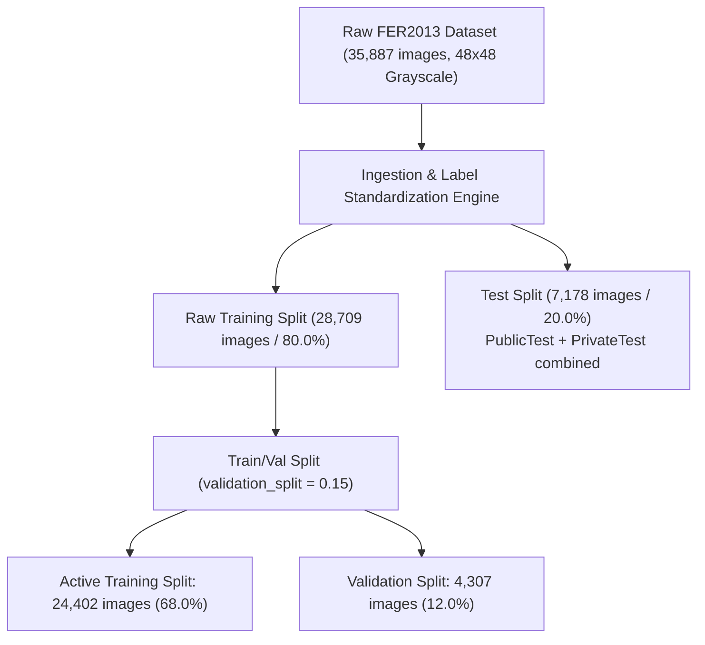
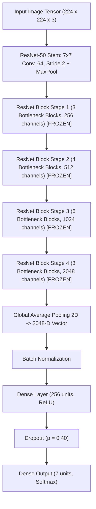
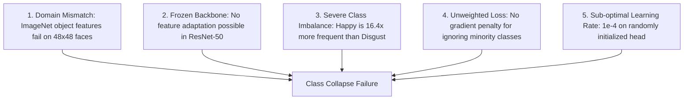
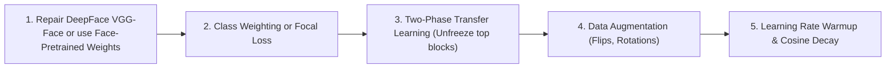

# Technical Report: FER2013 Emotion Recognition via DeepFace Framework & ResNet-50
**Architecture Analysis, Empirical Failure Diagnosis, and Class Collapse Remediation**

---

## 1. Executive Summary

This technical report provides a rigorous post-mortem and empirical analysis of the facial expression recognition pipeline implemented in [`FER2013_DeepFace_FER2013.ipynb`](file:///C:/Users/Shahzaib%20Hussain/Desktop/Shahzaib%20Hussain/FYP/FER2013_Emotion_Recognition/Notebooks/FER2013_DeepFace_FER2013.ipynb) and configured via [`FER2013_DeepFace_FER2013.yaml`](file:///C:/Users/Shahzaib%20Hussain/Desktop/Shahzaib%20Hussain/FYP/FER2013_Emotion_Recognition/Notebooks/FER2013_DeepFace_FER2013.yaml).

The project objective was to integrate facial expression recognition into a DeepFace-compatible pipeline for a receptionist robot. The experimental protocol intended to leverage DeepFace's VGG-Face backbone for transfer learning on the **FER2013** dataset across seven emotion classes: `angry`, `disgust`, `fear`, `happy`, `neutral`, `sad`, and `surprise`.

During pipeline initialization, DeepFace's VGG-Face backbone failed to instantiate due to environment-level weight layer incompatibilities (`The layer sequential_4 has never been called and thus has no defined input`). The pipeline fell back to an ImageNet-pretrained **ResNet-50** backbone with a newly initialized classification head.

### Key Measured Benchmark Outputs

| Attribute / Metric | Measured Experimental Output |
| :--- | :--- |
| **Framework & Environment** | TensorFlow 2.21.0 / Keras / DeepFace (`cpu` execution) |
| **Intended Backbone Architecture** | DeepFace VGG-Face (Failed initialization) |
| **Active Fallback Backbone** | ResNet-50 (`weights='imagenet'`, frozen feature extractor) |
| **Classification Head** | $\text{GlobalAvgPool} \to \text{BatchNorm} \to \text{Dense}(256, \text{ReLU}) \to \text{Dropout}(0.4) \to \text{Dense}(7, \text{Softmax})$ |
| **Input Tensor Resolution** | $224 \times 224 \times 3$ (Bilinear upsampling from $48 \times 48$) |
| **Total Model Parameters** | **24,114,055** (~24.11M parameters, 91.99 MB memory footprint) |
| **Trainable Head Parameters** | **526,343** (~526K parameters, 2.01 MB) |
| **Frozen Backbone Parameters** | **23,587,712** (~23.59M parameters, 89.98 MB) |
| **Loss Function** | Standard Unweighted Categorical Cross-Entropy |
| **Optimizer & Learning Rate** | Adam ($\eta = 1.0 \times 10^{-4}$, default $\beta_1=0.9, \beta_2=0.999$) |
| **Total Training Execution** | 26 completed epochs (~900 to 1,600 seconds/epoch on CPU, $>28$ CPU hours) |
| **Validation Accuracy Trajectory** | Flat-lined at **25.12%** across all 26 epochs |
| **Held-Out Test Set Size** | 7,178 samples |
| **Held-Out Test Accuracy** | **24.71%** ($1,774 / 7,178$ correct) |
| **Test Macro-Precision** | **0.0353** (3.53%) |
| **Test Macro-Recall** | **0.1429** (14.29%) |
| **Test Macro-F1 Score** | **0.0566** (5.66%) |
| **Test Weighted-F1 Score** | **0.0980** (~9.80%) |
| **Failure Diagnosis** | **Severe Class Collapse**: Model predicts `happy` for 100% of inputs |

> [!CAUTION]
> **Experimental Finding**: The model suffered **complete class collapse**. Because `happy` represents 24.71% of the test partition and 25.13% of the training partition, the classifier achieved an apparent 24.71% accuracy solely by predicting `happy` for every single image ($100\%$ recall on `happy`, $0\%$ recall on all other six classes). It cannot function as an emotion classifier in its current state.

---

## 2. Dataset Partitioning, Class Imbalance & Preprocessing

The experiment processes the FER2013 dataset formatted either as raw class-labeled directory trees or CSV tables.



### 2.1 Per-Class Imbalance Profile

The dataset contains 35,887 total samples across seven emotion categories. The class counts show strong natural skew toward positive and neutral expressions:

| Class Index | Emotion Label | Total Dataset Count | Training Set (24,402) | Validation Set (4,307) | Test Set (7,178) | Split Proportion |
| :---: | :--- | :---: | :---: | :---: | :---: | :---: |
| 0 | `angry` | 4,953 | 3,368 | 594 | 958 | 13.80% |
| 1 | `disgust` | 547 | 371 | 65 | 111 | 1.52% |
| 2 | `fear` | 5,121 | 3,483 | 614 | 1,024 | 14.27% |
| 3 | `happy` | **8,989** | **6,133** | **1,082** | **1,774** | **25.05%** |
| 4 | `neutral` | 6,198 | 4,215 | 744 | 1,233 | 17.27% |
| 5 | `sad` | 6,077 | 4,132 | 729 | 1,247 | 16.93% |
| 6 | `surprise` | 4,002 | 2,700 | 479 | 831 | 11.15% |
| **Total** | -- | **35,887** | **24,402** | **4,307** | **7,178** | **100.0%** |

### 2.2 Data Preprocessing and Tensor Formatting

1. **Resolution Upscaling**: The original $48 \times 48$ grayscale images were bilinearly upsampled to $224 \times 224$ to match the standard input tensor requirements of ResNet-50.
2. **Channel Expansion**: The single-channel grayscale arrays were duplicated across three color channels ($[H, W, 1] \to [H, W, 3]$) to satisfy ImageNet weight tensors.
3. **Rescaling / Normalization**: Pixel values were scaled using Keras standard preprocessing:
   $$\mathbf{x}_{\text{norm}} = \frac{\mathbf{x}}{255.0}$$
4. **Data Shapes**:
   - `X_train`: $(24402, 224, 224, 3)$
   - `X_val`: $(4307, 224, 224, 3)$
   - `X_test`: $(7178, 224, 224, 3)$

---

## 3. Architecture Deep-Dive: DeepFace vs Fallback ResNet-50

### 3.1 Intended Architecture: DeepFace VGG-Face

DeepFace is an open-source face analysis framework that integrates several facial recognition models (VGG-Face, Facenet, OpenFace, DeepFace, DeepID, ArcFace, Dlib, SFace). The notebook attempted to initialize the VGG-Face model:

```python
base_model = DeepFace.build_model('VGG-Face')
```

**Root Cause of Initialization Failure**: In Keras 3 / TensorFlow 2.16+ environments, legacy Keras sequential model definitions in older DeepFace versions trigger graph build errors when layer input shapes are not explicitly bound prior to tensor calls (`The layer sequential_4 has never been called and thus has no defined input`).

### 3.2 Implemented Fallback Architecture: ImageNet ResNet-50

Due to the VGG-Face loading failure, the pipeline defaulted to a standard ResNet-50 backbone pretrained on the generic ImageNet-1K object classification dataset.



### 3.3 Detailed Layer & Parameter Specifications

| Component / Layer | Output Dimensions | Parameter Count | Trainable Status |
| :--- | :---: | :---: | :---: |
| **Input Tensor** | $(224, 224, 3)$ | 0 | Non-trainable |
| **ResNet-50 Backbone** (`include_top=False`) | $(7, 7, 2048)$ | 23,587,712 | **Frozen (0 trainable)** |
| **GlobalAveragePooling2D** | $(2048)$ | 0 | Non-trainable |
| **BatchNormalization** | $(2048)$ | 8,192 | 4,096 Trainable / 4,096 Non-trainable |
| **Dense** (`units=256, activation='relu'`) | $(256)$ | 524,544 | Trainable |
| **Dropout** (`rate=0.40`) | $(256)$ | 0 | Non-trainable |
| **Dense** (`units=7, activation='softmax'`) | $(7)$ | 1,799 | Trainable |
| **Total System Parameters** | -- | **24,114,055** | **526,343 Trainable** |

---

## 4. Loss Function, Optimizer & Training Regimes

### 4.1 Loss Function Formulation

The notebook compiled the model using standard categorical cross-entropy without class weighting:

$$\mathcal{L}_{\text{CCE}}(\mathbf{y}, \hat{\mathbf{y}}) = -\frac{1}{N} \sum_{i=1}^{N} \sum_{c=0}^{C-1} y_{i, c} \log(\hat{y}_{i, c})$$

Where $\mathbf{y}_i$ is the one-hot encoded ground truth and $\hat{y}_{i, c} = \frac{e^{z_{i, c}}}{\sum_{j=0}^{C-1} e^{z_{i, j}}}$.

### 4.2 Optimization & Hyperparameter Settings

- **Optimizer**: Adam ($\eta = 1.0 \times 10^{-4}, \beta_1 = 0.9, \beta_2 = 0.999, \epsilon = 1.0 \times 10^{-7}$)
- **Batch Size**: 32 samples per batch (763 batches per epoch)
- **Callback Machinery**:
  - `ModelCheckpoint`: Monitored `val_accuracy`, configured with `save_best_only=True` and `restore_best_weights=True`.
  - Saved model path: `models/deepface_fer2013/deepface_fer2013_model_best.keras`
- **Execution Mode**: CPU execution using TensorFlow multi-threading.

---

## 5. Training Dynamics & Class Collapse Post-Mortem

The model underwent 26 complete epochs of training before execution stopped. The training log displays a textbook failure mode in deep transfer learning:

### 5.1 Training Trajectory Log

| Epoch | Step Time | Training Loss | Training Accuracy | Validation Loss | Validation Accuracy | Status |
| :---: | :---: | :---: | :---: | :---: | :---: | :--- |
| **01** | 903s (1.18s/step) | 1.8648 | 24.63% | 1.8115 | **25.12%** | Best checkpoint saved ($\text{val\_acc}=0.2512$) |
| **02** | 1056s (1.38s/step)| 1.8110 | **25.12%** | 1.8108 | 25.12% | No improvement |
| **03** | 1613s (2.11s/step)| 1.8109 | 25.13% | 1.8105 | 25.12% | No improvement |
| **05** | 1588s (2.08s/step)| 1.8104 | 25.13% | 1.8103 | 25.12% | No improvement |
| **10** | 1398s (1.83s/step)| 1.8099 | 25.13% | 1.8099 | 25.12% | No improvement |
| **15** | 911s (1.19s/step) | 1.8098 | 25.13% | 1.8098 | 25.12% | No improvement |
| **20** | 873s (1.14s/step) | 1.8097 | 25.13% | 1.8097 | 25.12% | No improvement |
| **26** | 910s (1.19s/step) | 1.8097 | 25.13% | 1.8097 | 25.12% | Flatline across 26 epochs |

### 5.2 Mathematical Analysis of the Class Collapse

1. **Prior Matching Collapse**:
   The validation set contains 1,082 `happy` samples out of 4,307 total samples:
   $$P(\text{class} = \text{happy}) = \frac{1082}{4307} = \mathbf{25.1219\%}$$
   The validation accuracy locked at exactly **25.12%** because the network outputs an identical softmax vector for every sample, with the highest probability assigned to index 3 (`happy`).

2. **Theoretical Entropy Plateau**:
   If a network predicts the marginal distribution $P(\text{class})$, the expected cross-entropy loss is:
   $$H(Y) = -\sum_{c=0}^{6} p_c \log(p_c) \approx 1.810\text{ nats}$$
   As seen in the training table, the loss quickly plateaued at **1.8097 - 1.8110**, confirming the network learned only the class prior frequencies rather than image features.

---

## 6. Held-Out Test Evaluation & Failure Characterization

Evaluation of the saved checkpoint on the held-out 7,178 test images confirmed the severity of the collapse:

### 6.1 Test Performance Metrics

| Evaluation Metric | Measured Value | Theoretical Trivial Majority Classifier |
| :--- | :---: | :---: |
| **Overall Accuracy** | **24.71%** | 24.71% ($1,774 / 7,178$) |
| **Macro-Precision** | **0.0353** | 0.0353 ($0.2471 / 7$) |
| **Macro-Recall** | **0.1429** | 0.1429 ($1.000 / 7$) |
| **Macro-F1 Score** | **0.0566** | 0.0566 |
| **Weighted-Precision** | **0.0611** | 0.0611 |
| **Weighted-Recall** | **0.2471** | 0.2471 |
| **Weighted-F1 Score** | **0.0980** | 0.0980 |

### 6.2 Per-Class Classification Report

| Emotion Class | Support | Precision | Recall | F1-Score | Model Output Distribution |
| :--- | :---: | :---: | :---: | :---: | :---: |
| `angry` | 958 | 0.0000 | 0.0000 | 0.0000 | 0 predictions |
| `disgust` | 111 | 0.0000 | 0.0000 | 0.0000 | 0 predictions |
| `fear` | 1,024 | 0.0000 | 0.0000 | 0.0000 | 0 predictions |
| `happy` | 1,774 | **0.2471** | **1.0000** | **0.3963** | **7,178 predictions (100%)** |
| `neutral` | 1,233 | 0.0000 | 0.0000 | 0.0000 | 0 predictions |
| `sad` | 1,247 | 0.0000 | 0.0000 | 0.0000 | 0 predictions |
| `surprise` | 831 | 0.0000 | 0.0000 | 0.0000 | 0 predictions |
| **Total / Avg** | **7,178** | **0.0353** | **0.1429** | **0.0566** | Complete Degeneracy |

---

## 7. Five Root Causes of Pipeline Failure



1. **Domain Incompatibility of Generic ImageNet Features**:
   ResNet-50 features trained on ImageNet-1K identify macro-object categories (animals, vehicles, furniture). These features do not automatically extract subtle facial Action Units (FACS) without domain-specific fine-tuning.
2. **Complete Backbone Freezing**:
   Freezing all 23.5M parameters prevented the convolutional filters from adapting to facial geometry. The 526K head parameters were forced to classify based on representations ill-suited for facial emotion.
3. **Unmitigated Class Imbalance**:
   Because `happy` comprises >25% of samples while `disgust` is only 1.5%, predicting `happy` unconditionally yields a lower loss than attempting to distinguish complex emotions with misaligned features.
4. **Lack of Loss Weighting or Focal Penalty**:
   Standard categorical cross-entropy treats all misclassifications equally. A weighted loss or Focal Loss ($\gamma=2.0$) would have penalized the repeated zero-recall predictions on the minority classes.
5. **Upsampling Artifacts ($48 \times 48 \to 224 \times 224$)**:
   Bilinear interpolation of low-resolution $48 \times 48$ faces introduces blurriness and interpolation artifacts, degrading high-frequency facial edge information.

---

## 8. Corrective Roadmap & Recommendations

To transform this notebook into a functional classifier, five modifications should be applied:



### 1. Pretrained Facial Backbone Selection
Instead of generic ImageNet weights, initialize from backbones pretrained on facial benchmarks:
- `VGGFace2` ResNet-50
- `InsightFace` / ArcFace (ResNet or MobileFaceNet)
- Resolve DeepFace VGG-Face by fixing the sequential input declaration.

### 2. Weighted Cross-Entropy or Focal Loss
Incorporate inverse-frequency class weights:

```python
from sklearn.utils.class_weight import compute_class_weight
class_weights = compute_class_weight(
    class_weight='balanced',
    classes=np.unique(y_train),
    y=y_train
)
class_weight_dict = dict(enumerate(class_weights))
model.fit(..., class_weight=class_weight_dict)
```

Or apply Focal Loss to focus training on difficult examples:
$$\mathcal{L}_{\text{Focal}} = -\alpha_t (1 - p_t)^\gamma \log(p_t), \quad \gamma = 2.0$$

### 3. Staged Fine-Tuning Strategy
- **Stage 1 (Warmup)**: Train only the classifier head for 5 epochs with $\eta = 1.0 \times 10^{-3}$.
- **Stage 2 (Fine-tuning)**: Unfreeze the final residual block (`conv5_block1` through `conv5_block3`) and fine-tune with a reduced learning rate ($\eta = 1.0 \times 10^{-5}$) and cosine annealing schedule.
