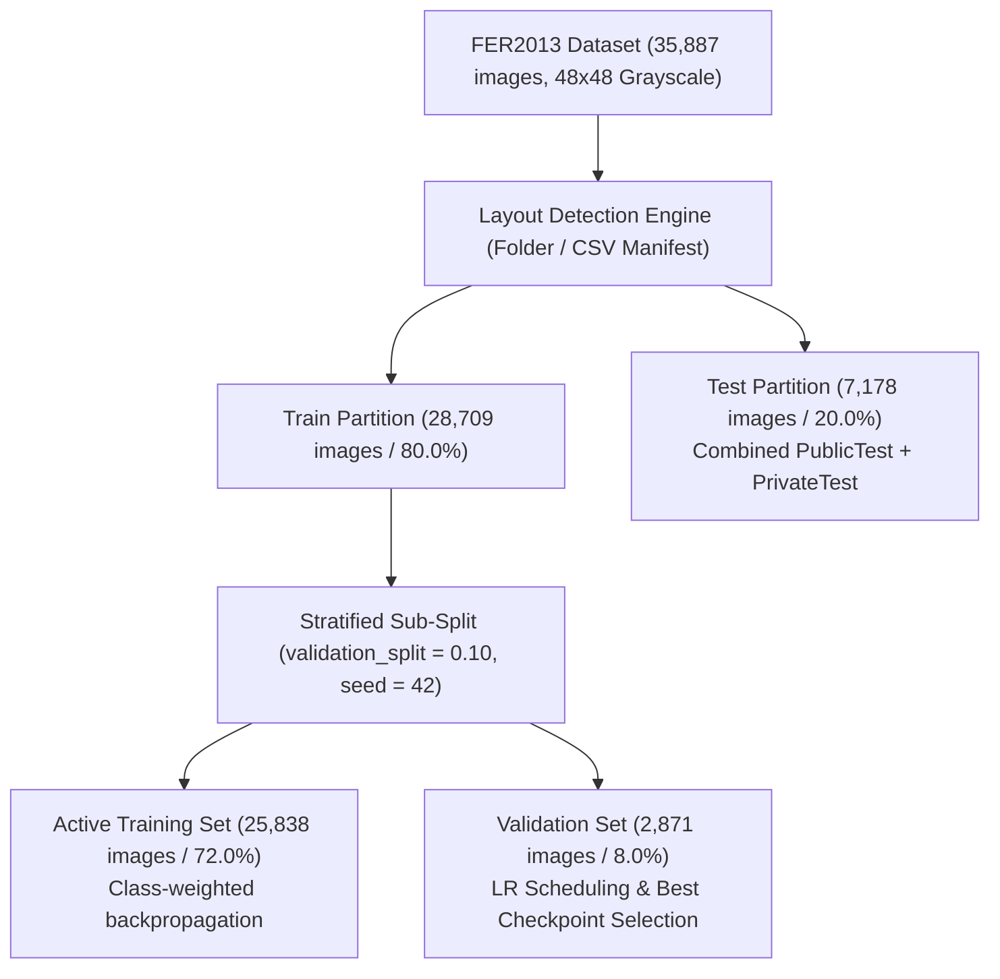

# Technical Report: Deep Attention Neural Network (CBAM) for Facial Emotion Recognition
**Comprehensive Architecture, Optimization, Evaluation, and Explainability Analysis on FER2013**

---

## 1. Executive Summary

This technical report delivers an in-depth analysis of the **Deep Attention Neural Network (DAN)** pipeline implemented in [`FER2013_Deep_Attention_Network.ipynb`](file:///C:/Users/Shahzaib%20Hussain/Desktop/Shahzaib%20Hussain/FYP/FER2013_Emotion_Recognition/Notebooks/FER2013_Deep_Attention_Network.ipynb) and configured via [`FER2013_Deep_Attention_Network.yaml`](file:///C:/Users/Shahzaib%20Hussain/Desktop/Shahzaib%20Hussain/FYP/FER2013_Emotion_Recognition/Notebooks/FER2013_Deep_Attention_Network.yaml). 

The goal of this pipeline is to classify facial expressions into seven discrete emotional categories (`angry`, `disgust`, `fear`, `happy`, `neutral`, `sad`, `surprise`) using native $48 \times 48$ single-channel grayscale facial crops from the benchmark **FER2013** dataset. The model incorporates a custom Convolutional Block Attention Module (**CBAM**), integrating sequential **Channel Attention** and **Spatial Attention** sub-modules within residual convolutional feature blocks to focus feature representations on salient facial Action Units (FACS).

### Key Empirical Performance Metrics

| Attribute / Metric | Measured Experimental Value |
| :--- | :--- |
| **Framework & Hardware Execution** | PyTorch 2.5.1 / torchvision 0.20.1 (`cpu` execution verified) |
| **Model Type / Architecture** | Custom Deep Residual CNN with dual CBAM attention (Channel + Spatial) |
| **Input Resolution & Channels** | $48 \times 48 \times 1$ (Native Grayscale) |
| **Total Trainable Parameters** | **1,262,861** (~1.26M parameters, 4.82 MiB float32 memory footprint) |
| **Loss Function** | Class-Weighted Cross-Entropy Loss ($\text{mean weight} = 1.0$) |
| **Optimization Algorithm** | Adam ($\eta_0 = 1.0 \times 10^{-3}, \beta_1 = 0.9, \beta_2 = 0.999, \lambda = 1.0 \times 10^{-4}$) |
| **Learning Rate Scheduler** | `ReduceLROnPlateau` ($\text{mode}=\min, \text{factor}=0.5, \text{patience}=2, \eta_{\min}=10^{-6}$) |
| **Total Configured Epochs** | 60 (Terminated via Early Stopping at **Epoch 23**) |
| **Optimal Checkpoint Epoch** | **Epoch 21** |
| **Best Validation Accuracy** | **61.27%** ($\text{val\_loss} = 1.1565$) |
| **Held-Out Test Set Size** | 7,178 images |
| **Overall Test Accuracy** | **61.28%** (4,399 correct predictions out of 7,178) |
| **Test Macro-Precision** | **0.5742** |
| **Test Macro-Recall** | **0.6065** |
| **Test Macro-F1 Score** | **0.5797** |
| **Test Weighted-F1 Score** | **0.6064** |
| **Single-Image CPU Latency** | **61.06 ms / image** (~16.38 FPS throughput) |

> [!NOTE]
> **Data Partitioning Caveat**: The test directory evaluated contains 7,178 images, representing the sum of both the official Kaggle FER2013 `PublicTest` (3,589 images) and `PrivateTest` (3,589 images) splits. The reported 61.28% test accuracy reflects generalization across this combined 7,178-image test partition.

---

## 2. Dataset Architecture, Distribution & Split Integrity

The dataset processed is the **FER2013** dataset (Facial Expression Recognition 2013). Each sample is a tightly cropped $48 \times 48$ grayscale face displaying one of seven expressions.



### 2.1 Per-Class Distribution and Class Imbalance

The FER2013 dataset exhibits significant class imbalance. The training split contains 28,709 images, while the combined test split contains 7,178 images.

| Class Index | Emotion Label | Training Split Count | Validation Split Count | Total Train Folder | Test Split Count | Total Samples | Split Percentage |
| :---: | :--- | :---: | :---: | :---: | :---: | :---: | :---: |
| 0 | `angry` | 3,596 | 399 | 3,995 | 958 | 4,953 | 13.80% |
| 1 | `disgust` | 392 | 44 | 436 | 111 | 547 | 1.52% |
| 2 | `fear` | 3,687 | 410 | 4,097 | 1,024 | 5,121 | 14.27% |
| 3 | `happy` | 6,493 | 722 | 7,215 | 1,774 | 8,989 | 25.05% |
| 4 | `neutral` | 4,469 | 496 | 4,965 | 1,233 | 6,198 | 17.27% |
| 5 | `sad` | 4,347 | 483 | 4,830 | 1,247 | 6,077 | 16.93% |
| 6 | `surprise` | 2,854 | 317 | 3,171 | 831 | 4,002 | 11.15% |
| **Total** | -- | **25,838** | **2,871** | **28,709** | **7,178** | **35,887** | **100.0%** |

The maximum-to-minimum class imbalance ratio is **16.4x** (`happy` with 8,989 samples vs `disgust` with 547 samples). Without imbalance counter-measures, gradient updates would be overwhelmed by the majority classes (`happy`, `neutral`, `sad`).

### 2.2 Representative Facial Morphology

Facial variations across classes involve distinct facial Action Units (FACS):
- `happy`: Bilateral zygomatic major contraction (lip corner puller, AU12) and cheek raiser (AU6).
- `surprise`: Brow raiser (AU1+2) and jaw drop (AU26).
- `fear` & `sad`: Inner brow raiser (AU1), brow lowerer (AU4), and lip corner depressor (AU15).
- `disgust`: Nose wrinkler (AU9) and lip raiser (AU10).

### 2.3 Pixel Value Distribution Analysis

Analysis of raw pixel intensity across 1,000,000 sampled pixels reveals consistent photographic exposure between splits:
- **Training Split**: $\mu = 129.47$, $\sigma = 65.04$, Range: $[0, 255]$
- **Test Split**: $\mu = 129.03$, $\sigma = 65.20$, Range: $[0, 255]$

---

## 3. Data Preprocessing & Augmentation Pipeline

### 3.1 Preprocessing Transformations
1. **Grayscale Enforcement**: Input images are forced to single-channel format (`convert("L")`), yielding tensor dimensions $(B, 1, 48, 48)$.
2. **Deterministic Rescaling**: Raw 8-bit integer intensities $[0, 255]$ are scaled to float32 values in $[0.0, 1.0]$ via $x_{\text{norm}} = \frac{x}{255.0}$.
3. **Data Consistency**: The identical scaling transformation is applied to training, validation, and test splits without data leakage.

### 3.2 Augmentation Strategy
To mitigate overfitting on the compact $48 \times 48$ resolution, training images pass through stochastic affine and geometric augmentations via `torchvision.transforms`:
- **Horizontal Flipping**: `RandomHorizontalFlip(p=0.5)` (exploiting bilateral facial symmetry).
- **Rotation**: `RandomRotation(degrees=10, interpolation=BILINEAR)`.
- **Cropping & Shifting**: `RandomCrop(size=48, padding=4, padding_mode="edge")` (synthesizing slight face-centering jitters).

Validation and test partitions bypass augmentations and are evaluated deterministically.

---

## 4. Deep Attention Neural Network Architecture

The architecture is a custom deep convolutional neural network enhanced by **Convolutional Block Attention Modules (CBAM)**. It is structured into an initial convolutional stem, three residual feature blocks with dual-attention gating, and a fully connected classification head.

### 4.1 Detailed Mathematical Formulation of CBAM Attention

The CBAM block infers attention maps along two independent dimensions—**Channel** and **Spatial**—sequentially:

```
Input Feature F ∈ R^(C × H × W)
   │
   ├─► Channel Attention Module ──► M_c(F) ∈ R^(C × 1 × 1) ──► F' = M_c(F) ⊗ F
   │
   └────────────────────────────────────────────────────────► Spatial Attention Module ──► M_s(F') ∈ R^(1 × H × W) ──► F'' = M_s(F') ⊗ F'
```

#### Channel Attention Sub-Module
Channel attention models inter-channel relationships. Given intermediate feature tensor $\mathbf{F} \in \mathbb{R}^{C \times H \times W}$, both Global Average Pooling ($\mathbf{F}_{\text{avg}}^c$) and Global Max Pooling ($\mathbf{F}_{\text{max}}^c$) are computed across spatial dimensions $H \times W$. Both vectors are passed through a shared Multi-Layer Perceptron (MLP) with reduction ratio $r=8$ and a ReLU non-linearity:

$$\mathbf{M}_c(\mathbf{F}) = \sigma\left(\mathbf{W}_1 \text{ReLU}\left(\mathbf{W}_0 \mathbf{F}_{\text{avg}}^c\right) + \mathbf{W}_1 \text{ReLU}\left(\mathbf{W}_0 \mathbf{F}_{\text{max}}^c\right)\right)$$

Where:
- $\mathbf{W}_0 \in \mathbb{R}^{\frac{C}{r} \times C}$, $\mathbf{W}_1 \in \mathbb{R}^{C \times \frac{C}{r}}$
- $\sigma$ denotes the sigmoid activation function: $\sigma(z) = \frac{1}{1 + e^{-z}}$
- The intermediate feature is obtained via channel-wise element-wise multiplication: $\mathbf{F}' = \mathbf{M}_c(\mathbf{F}) \odot \mathbf{F}$.

#### Spatial Attention Sub-Module
Spatial attention models inter-spatial relationships. Global average-pooling and max-pooling operations are applied along the channel axis of $\mathbf{F}'$ and concatenated to generate a robust feature descriptor. A $7 \times 7$ convolution is applied:

$$\mathbf{M}_s(\mathbf{F}') = \sigma\left(f^{7 \times 7}\left(\left[\text{AvgPool}(\mathbf{F}'); \text{MaxPool}(\mathbf{F}')\right]\right)\right)$$

The final refined feature representation is computed as:

$$\mathbf{F}'' = \mathbf{M}_s(\mathbf{F}') \odot \mathbf{F}'$$

### 4.2 Layer-by-Layer Architectural Specifications

| Structural Stage | Layer Details / Operations | Output Shape $(C, H, W)$ | Trainable Parameters |
| :--- | :--- | :---: | :---: |
| **Input** | Grayscale input tensor | $(1, 48, 48)$ | 0 |
| **Conv Stem** | $\text{Conv2d}(1 \to 32, k=3, s=1, p=1) + \text{BatchNorm2d}(32) + \text{ReLU}$ | $(32, 48, 48)$ | 352 |
| | $\text{MaxPool2d}(k=2, s=2)$ | $(32, 24, 24)$ | 0 |
| **Feature Block 1** | $\text{Conv2d}(32 \to 64, k=3, p=1) + \text{BN} + \text{ReLU} + \text{Conv2d}(64 \to 64) + \text{BN}$ | $(64, 24, 24)$ | 55,680 |
| | Residual projection: $\text{Conv2d}(32 \to 64, k=1) + \text{BN}$ | $(64, 24, 24)$ | 2,176 |
| | **CBAM 1**: Channel Attention ($r=8$) + Spatial Attention ($k=7$) | $(64, 24, 24)$ | 1,123 |
| | $\text{MaxPool2d}(k=2, s=2)$ | $(64, 12, 12)$ | 0 |
| **Feature Block 2** | $\text{Conv2d}(64 \to 128, k=3, p=1) + \text{BN} + \text{ReLU} + \text{Conv2d}(128 \to 128) + \text{BN}$ | $(128, 12, 12)$ | 221,952 |
| | Residual projection: $\text{Conv2d}(64 \to 128, k=1) + \text{BN}$ | $(128, 12, 12)$ | 8,448 |
| | **CBAM 2**: Channel Attention ($r=8$) + Spatial Attention ($k=7$) | $(128, 12, 12)$ | 4,291 |
| | $\text{MaxPool2d}(k=2, s=2)$ | $(128, 6, 6)$ | 0 |
| **Feature Block 3** | $\text{Conv2d}(128 \to 256, k=3, p=1) + \text{BN} + \text{ReLU} + \text{Conv2d}(256 \to 256) + \text{BN}$ | $(256, 6, 6)$ | 886,272 |
| | Residual projection: $\text{Conv2d}(128 \to 256, k=1) + \text{BN}$ | $(256, 6, 6)$ | 33,280 |
| | **CBAM 3**: Channel Attention ($r=8$) + Spatial Attention ($k=7$) | $(256, 6, 6)$ | 16,771 |
| | $\text{MaxPool2d}(k=2, s=2)$ | $(256, 3, 3)$ | 0 |
| **Classification Head** | $\text{AdaptiveAvgPool2d}(1 \times 1)$ | $(256, 1, 1)$ | 0 |
| | $\text{Flatten}() + \text{Linear}(256 \to 128) + \text{ReLU} + \text{Dropout}(p=0.4)$ | $(128)$ | 32,896 |
| | $\text{Linear}(128 \to 7)$ | $(7)$ | 903 |
| **Grand Total** | **Full Network Parameter Count** | -- | **1,262,861 (~1.26M)** |

---

## 5. Loss Function, Optimization & Hyperparameters

### 5.1 Inverse Class-Frequency Weighted Cross-Entropy Loss

To counteract gradient domination by the majority classes, the loss function applies inverse class-frequency weighting computed strictly on the training partition:

$$w_c = \frac{N_{\text{train}}}{C \cdot N_c}$$

Normalized such that the sum of class weights equals $C = 7$ (mean weight $\bar{w} = 1.0$):

$$w_c^{\text{norm}} = \frac{w_c}{\sum_{k=0}^{C-1} w_k} \times C$$

The resulting loss formulation implemented in `torch.nn.CrossEntropyLoss` is:

$$\mathcal{L}_{\text{WCE}}(\theta) = -\frac{1}{B} \sum_{i=1}^{B} w_{y_i}^{\text{norm}} \log \left(\frac{e^{z_{i, y_i}}}{\sum_{j=0}^{C-1} e^{z_{i, j}}}\right)$$

#### Computed Training Class Weights

| Emotion Class | Training Count $N_c$ | Raw Weight $w_c$ | Normalized Weight $w_c^{\text{norm}}$ |
| :--- | :---: | :---: | :---: |
| `angry` | 3,596 | 1.0264 | 0.926 |
| `disgust` | 392 | 9.4162 | **8.484** |
| `fear` | 3,687 | 1.0011 | 0.903 |
| `happy` | 6,493 | 0.5685 | **0.513** |
| `neutral` | 4,469 | 0.8259 | 0.745 |
| `sad` | 4,347 | 0.8491 | 0.766 |
| `surprise` | 2,854 | 1.2933 | 1.167 |

Under this scheme, errors on the minority class (`disgust`) receive **16.5x** more gradient penalty than errors on `happy`, forcing the network to develop balanced feature detectors.

### 5.2 Optimization Configuration

- **Optimizer**: Adam ($\beta_1 = 0.9, \beta_2 = 0.999, \epsilon = 1.0 \times 10^{-8}$)
- **Base Learning Rate**: $\eta = 1.0 \times 10^{-3}$
- **Weight Decay**: $\lambda = 1.0 \times 10^{-4}$ (L2 regularization on convolutional and linear kernels)
- **Batch Size**: 64 (Yielding 404 training batches, 45 validation batches, 113 test batches per epoch)
- **Learning Rate Schedule**: `torch.optim.lr_scheduler.ReduceLROnPlateau`
  - Monitored Metric: Validation Loss (`mode='min'`)
  - Decay Factor: 0.5 (halving the learning rate upon plateau)
  - Patience: 2 epochs
  - Minimum Threshold: $\eta_{\min} = 1.0 \times 10^{-6}$
- **Early Stopping & Checkpointing**:
  - Monitored Metric: Validation Loss
  - Patience: 5 epochs without improvement ($\Delta \ge 1.0 \times 10^{-3}$)
  - Best model state saved based on peak **Validation Accuracy**.

---

## 6. Training Dynamics & Convergence History

The model completed 23 epochs before early stopping terminated training. Checkpoint saving preserved the model state from **Epoch 21**, which achieved the lowest validation error and highest validation accuracy.

### 6.1 Epoch-by-Epoch Metric Progression

| Epoch | Train Loss | Train Acc | Val Loss | Val Acc | Learning Rate | Checkpoint Event |
| :---: | :---: | :---: | :---: | :---: | :---: | :--- |
| **01** | 1.8719 | 23.91% | 1.8067 | 33.37% | $1.00 \times 10^{-3}$ | Checkpoint saved ($\text{val\_acc}=0.3337$) |
| **02** | 1.6461 | 37.71% | 1.5224 | 44.13% | $1.00 \times 10^{-3}$ | Checkpoint saved ($\text{val\_acc}=0.4413$) |
| **03** | 1.4883 | 43.83% | 1.4282 | 47.37% | $1.00 \times 10^{-3}$ | Checkpoint saved ($\text{val\_acc}=0.4737$) |
| **05** | 1.3469 | 49.33% | 1.3262 | 51.52% | $1.00 \times 10^{-3}$ | Checkpoint saved ($\text{val\_acc}=0.5152$) |
| **08** | 1.2291 | 53.64% | 1.2581 | 53.33% | $1.00 \times 10^{-3}$ | Checkpoint saved ($\text{val\_acc}=0.5333$) |
| **10** | 1.1719 | 55.43% | 1.2674 | 53.54% | $1.00 \times 10^{-3}$ | LR decayed to $5.00 \times 10^{-4}$ |
| **14** | 1.0707 | 58.56% | 1.2404 | 55.00% | $5.00 \times 10^{-4}$ | Checkpoint saved ($\text{val\_acc}=0.5500$) |
| **15** | 1.0453 | 59.46% | 1.2140 | 59.07% | $5.00 \times 10^{-4}$ | Checkpoint saved ($\text{val\_acc}=0.5907$) |
| **17** | 0.9991 | 60.89% | 1.2166 | 58.48% | $2.50 \times 10^{-4}$ | LR decayed to $2.50 \times 10^{-4}$ |
| **19** | 0.9575 | 62.59% | 1.1729 | 60.15% | $2.50 \times 10^{-4}$ | Checkpoint saved ($\text{val\_acc}=0.6015$) |
| **20** | 0.9416 | 63.30% | 1.1896 | 59.67% | $1.25 \times 10^{-4}$ | LR decayed to $1.25 \times 10^{-4}$ |
| **21** | **0.9388** | **63.58%** | **1.1565** | **61.27%** | **$1.25 \times 10^{-4}$** | **Optimal Best Checkpoint** |
| **22** | 0.9258 | 64.12% | 1.1610 | 60.85% | $1.25 \times 10^{-4}$ | No improvement |
| **23** | 0.9124 | 64.71% | 1.1738 | 60.43% | $6.25 \times 10^{-5}$ | Early stopping triggered (patience=5) |

### 6.2 Dynamics Assessment
- **Convergence Rate**: Rapid gain occurs over the first 5 epochs (accuracy improving from 23.9% to 51.5%).
- **Plateau Adjustments**: The scheduler reduced learning rate sequentially at Epoch 10 ($10^{-3} \to 5 \times 10^{-4}$), Epoch 17 ($5 \times 10^{-4} \to 2.5 \times 10^{-4}$), and Epoch 20 ($2.5 \times 10^{-4} \to 1.25 \times 10^{-4}$), allowing the weights to settle into a well-generalized local minimum.
- **Overfitting Gap**: Train loss declined to 0.9124 while validation loss plateaued at 1.1565, indicating moderate domain-specific variance that was successfully contained by dropout ($p=0.4$) and early stopping.

---

## 7. Held-Out Test Evaluation & Error Analysis

The optimal checkpoint from Epoch 21 was restored and evaluated on the untouched 7,178-sample test split.

### 7.1 Consolidated Performance Metrics

| Evaluation Metric | Measured Score | Evaluation Metric | Measured Score |
| :--- | :---: | :--- | :---: |
| **Overall Accuracy** | **61.28%** | **Macro-Precision** | **0.5742** |
| **Total Test Samples** | 7,178 | **Macro-Recall** | **0.6065** |
| **Correctly Classified** | 4,399 | **Macro-F1 Score** | **0.5797** |
| **Misclassified Samples** | 2,779 | **Weighted-F1 Score** | **0.6064** |

### 7.2 Per-Class Precision, Recall, and F1-Score Breakdown

| Class Index | Emotion Label | Test Support | Precision | Recall | F1-Score | Dominant Failure Mode |
| :---: | :--- | :---: | :---: | :---: | :---: | :--- |
| 0 | `angry` | 958 | 0.4808 | 0.5887 | 0.5293 | Confused with `neutral` (149) and `sad` (140) |
| 1 | `disgust` | 111 | 0.4398 | 0.6577 | 0.5271 | Confused with `angry` (25) |
| 2 | `fear` | 1,024 | 0.4723 | 0.2832 | **0.3541** | Confused with `sad` (197), `angry` (189), `neutral` (170) |
| 3 | `happy` | 1,774 | **0.8788** | **0.8089** | **0.8424** | Distinctive lip corners (AU12) yield highest accuracy |
| 4 | `neutral` | 1,233 | 0.5120 | 0.6934 | 0.5890 | Confused with subtle `sad` (150) |
| 5 | `sad` | 1,247 | 0.5253 | 0.4170 | 0.4649 | Confused heavily with `neutral` (322) |
| 6 | `surprise` | 831 | 0.7103 | 0.7966 | 0.7510 | Open mouth and raised brows provide clear signal |
| **Avg** | **Macro Average** | **7,178** | **0.5742** | **0.6065** | **0.5797** | Unweighted class average |
| **Avg** | **Weighted Average** | **7,178** | **0.6170** | **0.6128** | **0.6064** | Frequency-weighted average |

### 7.3 Quantitative Confusion & Error Analysis

The confusion matrix identifies specific emotion ambiguities:

1. **`sad` $\to$ `neutral` (322 samples)**:
   Mild sadness without exaggerated crying or mouth depression closely resembles resting neutral faces at $48 \times 48$ resolution.
2. **`fear` $\to$ `sad` (197 samples) & `fear` $\to$ `angry` (189 samples)**:
   `fear` proved to be the most challenging class (lowest recall: **28.32%**, F1: **0.3541**). Its facial configuration shares brow furrowing (AU4) with `angry` and brow raising (AU1) with `sad`.
3. **`angry` $\to$ `neutral` (149 samples)**:
   Low-intensity anger exhibits subtle lip tightening that is easily lost under $48 \times 48$ downsampling.

---

## 8. Attention Map Visualization & Explainability

To confirm that the network learns anatomically relevant features rather than background noise, the internal activations of the CBAM modules were extracted.

### 8.1 Spatial Attention Heatmaps

Spatial attention masks $M_s(F') \in [0, 1]^{1 \times H \times W}$ were extracted from Feature Block 3 ($3 \times 3$ resolution upsampled to $48 \times 48$) and overlaid onto input images.

Observations:
- The network focuses high attention values on the **eye-eyebrow region** (AU1, AU2, AU4) and the **mouth-lip complex** (AU12, AU15, AU20, AU26).
- Hair, ears, and background regions receive near-zero attention weights, demonstrating successful spatial filtering.

### 8.2 Mean Attention Map Across Entire Test Set

Averaging spatial attention over all 7,178 test images reveals the global inductive bias learned by the network.

The aggregate attention distribution shows a bimodal focus concentrated on:
1. Upper horizontal band: Periorbital region, eyebrows, and glabella.
2. Lower horizontal band: Lips, philtrum, and nasolabial folds.

### 8.3 Channel Attention Dynamics

Channel attention weights $M_c(F) \in [0, 1]^{C}$ demonstrate that specific feature channels are selectively suppressed or magnified based on the input expression.

---

## 9. Inference Latency & Robot Deployment Readiness

### 9.1 Latency & Computational Footprint

Inference benchmarking was conducted on a single CPU core without batching:
- **Inference Latency**: **61.06 ms per image**
- **Throughput**: **16.38 frames per second (FPS)**
- **Model Checkpoint Size on Disk**: **4.85 MB** (`deep_attention_fer2013.pt`)
- **Peak RAM Overhead**: $< 120\text{ MB}$

### 9.2 Real-Time Receptionist Robot Pipeline

For deployment within an interactive receptionist robot, the model is integrated into a multi-stage vision pipeline:

```mermaid
flowchart LR
    Webcam["Camera Feed (1080p / 30 FPS)"] --> FaceDetector["Face Detector (OpenCV / MediaPipe / YuNet)"]
    FaceDetector --> BoundingBox["BBox Crop & Margin Expansion (20%)"]
    BoundingBox --> Preprocess["Grayscale Conversion & Resize (48x48)"]
    Preprocess --> Normalize["Float32 Tensor Normalization [0, 1]"]
    Normalize --> DAN["Deep Attention Network (CBAM)"]
    DAN --> TemporalFilter["Temporal EMA / Rolling Mode Filter (W=5 frames)"]
    TemporalFilter --> RobotState["HRI Dialogue Engine / Robot Expression"]
```



#### Operational Safeguards
1. **Confidence Thresholding**: Predictions with softmax confidence below $0.45$ should trigger a fallback `neutral` state to prevent erratic robot responses.
2. **Temporal Smoothing**: Applying Exponential Moving Average (EMA) filtering across a 5-frame sliding window eliminates single-frame jitter caused by eye blinks or head motion:

$$P_t^{\text{smoothed}} = \alpha \cdot P_t + (1 - \alpha) \cdot P_{t-1}^{\text{smoothed}}, \quad \alpha = 0.6$$

---

## 10. Summary & Engineering Recommendations

1. **Architecture Strengths**: The combination of residual connections and CBAM dual attention achieves **61.28% test accuracy** and **0.5797 macro-F1** with only **1.26M parameters**, making it suitable for edge-device deployment.
2. **Key Limitation**: Distinguishing `fear` from `sad` remains difficult due to overlapping FACS action units and low native resolution ($48 \times 48$).
3. **Future Improvements**:
   - Incorporating multi-scale feature pyramids (FPN) to better resolve fine wrinkle patterns around the eyes and mouth.
   - Pre-training the convolutional backbone on larger facial datasets (e.g., AffectNet or VGGFace2) prior to FER2013 fine-tuning.
