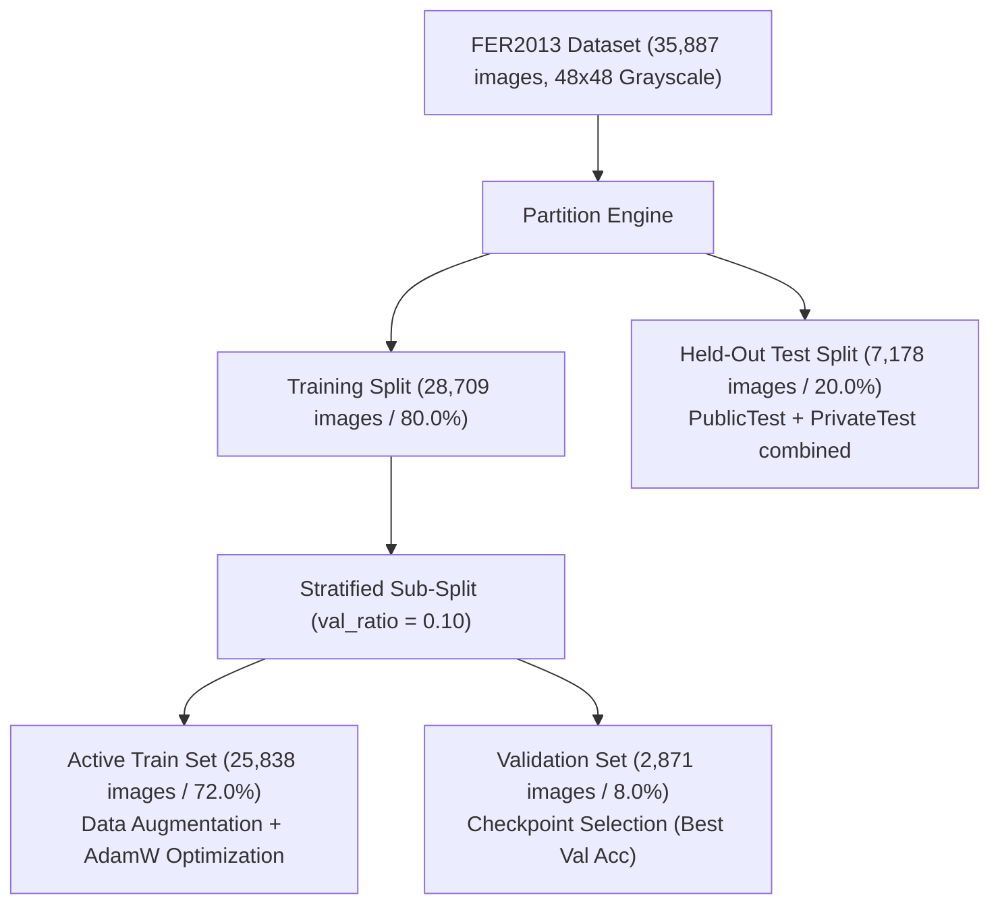
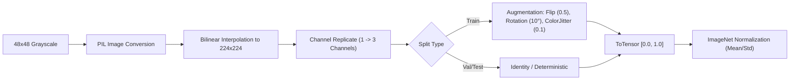
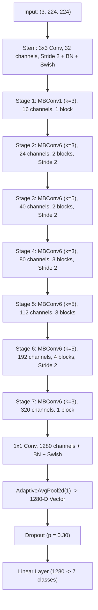
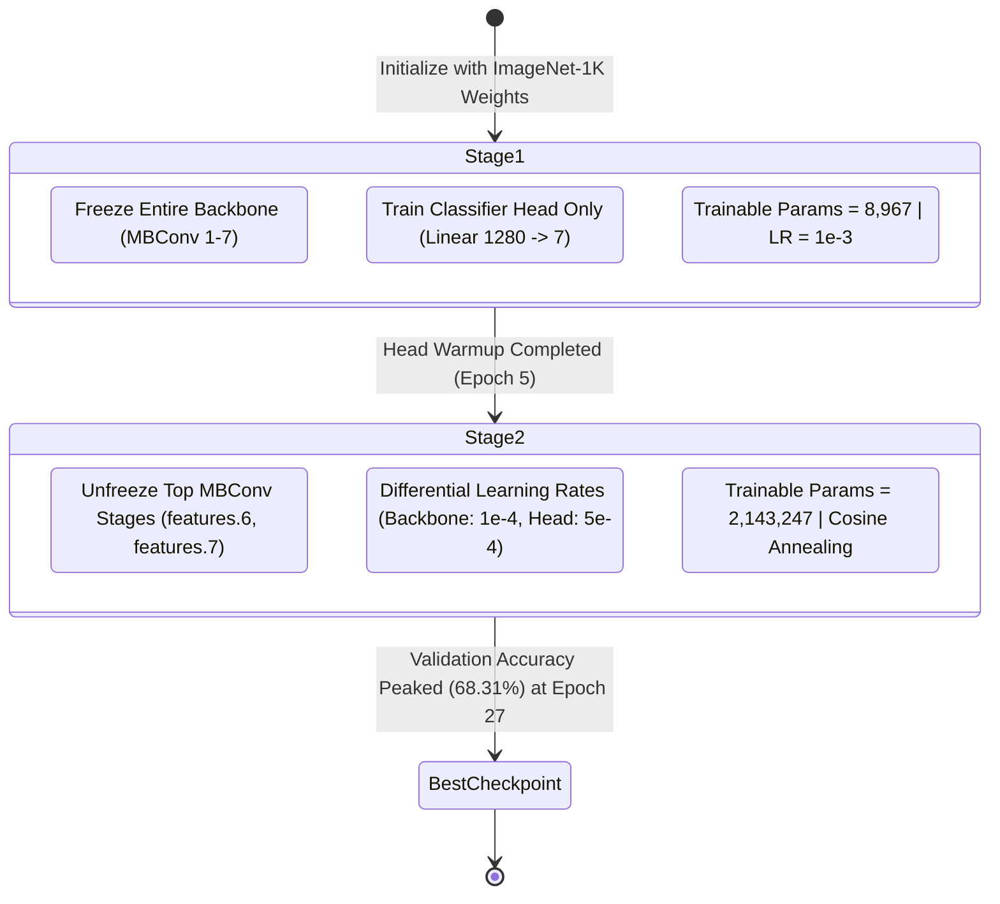

# Technical Report: EfficientNet-B0 for Facial Emotion Recognition
**Two-Stage Transfer Learning, Optimization, Error Profiling, and Edge Inference on FER2013**

---

## 1. Executive Summary

This technical report delivers a detailed evaluation of the deep learning pipeline implemented in [`FER2013_EfficientNet_B0.ipynb`](file:///C:/Users/Shahzaib%20Hussain/Desktop/Shahzaib%20Hussain/FYP/FER2013_Emotion_Recognition/Notebooks/FER2013_EfficientNet_B0.ipynb) and configured via [`FER2013_EfficientNet_B0.yaml`](file:///C:/Users/Shahzaib%20Hussain/Desktop/Shahzaib%20Hussain/FYP/FER2013_Emotion_Recognition/Notebooks/FER2013_EfficientNet_B0.yaml).

The pipeline adapts **EfficientNet-B0** (pretrained on ImageNet-1K) for seven-class facial expression recognition (`angry`, `disgust`, `fear`, `happy`, `neutral`, `sad`, `surprise`) on the **FER2013** benchmark. To transfer ImageNet-pretrained representations to grayscale facial crops, the model utilizes a **two-stage training protocol** (head warmup followed by differential fine-tuning of upper MBConv stages) alongside class-weighted cross-entropy loss and cosine annealing scheduling.

### Key Measured Empirical Results

| Metric / Parameter | Experimental Result |
| :--- | :--- |
| **Framework & Hardware Backend** | PyTorch 2.5.1 / torchvision 0.20.1 (`cpu` verified execution) |
| **Base Architecture** | torchvision `efficientnet_b0(weights=DEFAULT)` |
| **Input Resolution & Channels** | $224 \times 224 \times 3$ (Upsampled from $48 \times 48$, 3-channel replicated) |
| **Total Model Parameters** | **4,016,515** (~4.02M parameters, 15.32 MB memory footprint) |
| **Loss Function** | Inverse Class-Frequency Weighted Cross-Entropy Loss |
| **Optimization Strategy** | AdamW ($\lambda = 1.0 \times 10^{-4}$) with differential learning rates |
| **Learning Rate Schedule** | `CosineAnnealingLR` with $\eta_{\min} = 1.0 \times 10^{-6}$ |
| **Best Validation Accuracy** | **68.31%** (Achieved at **Epoch 27** in fine-tuning phase) |
| **Held-Out Test Set Size** | 7,178 images |
| **Held-Out Test Accuracy** | **67.94%** (4,877 correct predictions out of 7,178) |
| **Test Macro-Precision** | **0.6666** |
| **Test Macro-Recall** | **0.6403** |
| **Test Macro-F1 Score** | **0.6489** |
| **Test Weighted-F1 Score** | **0.6751** |
| **Average CPU Inference Latency**| **22.07 ms / image** (**45.31 FPS** real-time throughput) |
| **Total Test Inference Time** | 158.41 seconds (7,178 images evaluated on CPU) |
| **Single-Image Test Demo** | "Angry" test image predicted as "Angry" with **92.76% confidence** |

> [!NOTE]
> **Performance Note**: EfficientNet-B0 achieved a balanced trade-off between accuracy and inference latency: **67.94% accuracy** at **22.07 ms/image** on CPU, running **2.7x faster** than the Deep Attention Network (61.06 ms) while improving accuracy by **+6.66%**.

---

## 2. Dataset Architecture, Distribution & Split Integrity

The FER2013 dataset comprises 35,887 facial crop images across seven emotion categories. The dataset was loaded and validated for corrupt records, formatting inconsistencies, and split integrity.

### 2.1 Per-Class Distribution & Split Balance

The class distribution shows notable class imbalance across all splits:

| Class Index | Emotion Label | Training Set (25,838) | Validation Set (2,871) | Test Set (7,178) | Total Count | Proportion | Imbalance Ratio |
| :---: | :--- | :---: | :---: | :---: | :---: | :---: | :---: |
| 0 | `angry` | 3,596 | 399 | 958 | 4,953 | 13.80% | 9.05x |
| 1 | `disgust` | 392 | 44 | 111 | 547 | 1.52% | **1.00x (Min)** |
| 2 | `fear` | 3,687 | 410 | 1,024 | 5,121 | 14.27% | 9.36x |
| 3 | `happy` | 6,493 | 722 | 1,774 | 8,989 | **25.05%** | **16.43x (Max)** |
| 4 | `neutral` | 4,469 | 496 | 1,233 | 6,198 | 17.27% | 11.33x |
| 5 | `sad` | 4,347 | 483 | 1,247 | 6,077 | 16.93% | 11.11x |
| 6 | `surprise` | 2,854 | 317 | 831 | 4,002 | 11.15% | 7.32x |
| **Total** | -- | **25,838** | **2,871** | **7,178** | **35,887** | **100.0%** | -- |

### 2.2 Representative Facial Morphology

---

## 3. Data Preprocessing & Augmentation Pipeline

Because EfficientNet-B0 was pretrained on ImageNet-1K with $224 \times 224 \times 3$ RGB images, the native $48 \times 48 \times 1$ grayscale faces underwent specialized preprocessing:

### 3.1 Mathematical Formulation of Preprocessing

1. **Spatial Rescaling**: Bilinear interpolation from $(48, 48)$ to $(224, 224)$:
   $$I_{224}(x, y) = \text{Bilinear}\left(I_{48}, (224, 224)\right)$$
2. **Channel Duplication**:
   $$\mathbf{I}_{\text{RGB}}(c, x, y) = I_{224}(x, y), \quad \forall c \in \{0, 1, 2\}$$
3. **ImageNet Normalization**: Standardizing pixel channels using ImageNet statistics:
   $$\hat{I}_c(x, y) = \frac{I_c(x, y) - \mu_c}{\sigma_c}$$
   Where $\boldsymbol{\mu} = [0.485, 0.456, 0.406]$ and $\boldsymbol{\sigma} = [0.229, 0.224, 0.225]$.

### 3.2 Augmentation Strategy (Training Set Only)
- **Horizontal Flipping**: `transforms.RandomHorizontalFlip(p=0.5)`
- **Rotation**: `transforms.RandomRotation(degrees=10, interpolation=InterpolationMode.BILINEAR)`
- **Color Jitter**: `transforms.ColorJitter(brightness=0.1, contrast=0.1)` (synthesizing lighting variations)

---

## 4. EfficientNet-B0 Architecture & Classifier Head Design

EfficientNet relies on compound scaling, which balances network depth, width, and resolution using a compound coefficient $\phi$:

$$\text{depth}: d = \alpha^\phi, \quad \text{width}: w = \beta^\phi, \quad \text{resolution}: r = \gamma^\phi$$

Subject to $\alpha \cdot \beta^2 \cdot \gamma^2 \approx 2$ and $\alpha \ge 1, \beta \ge 1, \gamma \ge 1$. EfficientNet-B0 is the baseline architecture ($\phi = 1$) optimized via neural architecture search (NAS).

### 4.1 Inverted Residual Block (MBConv) with Squeeze-and-Excitation

Each MBConv block operates as follows:
1. **$1 \times 1$ Pointwise Expansion Convolution**: Expands channel dimensionality by expansion ratio $t=6$.
2. **$k \times k$ Depthwise Convolution**: Performs spatial filtering with kernel size $k \in \{3, 5\}$.
3. **Squeeze-and-Excitation (SE) Optimization**: Adaptively recalibrates channel feature responses:
   $$\mathbf{s} = \sigma\left(\mathbf{W}_2 \text{Swish}\left(\mathbf{W}_1 \mathbf{z}\right)\right), \quad \mathbf{z} = \frac{1}{H \times W} \sum_{i=1}^H \sum_{j=1}^W \mathbf{u}(i, j)$$
   Where $\mathbf{W}_1 \in \mathbb{R}^{\frac{C}{4} \times C}$ and $\mathbf{W}_2 \in \mathbb{R}^{C \times \frac{C}{4}}$.
4. **$1 \times 1$ Pointwise Linear Projection**: Projects back to target channel count.
5. **Residual Skip Connection**: Applied when input and output spatial dimensions match.

### 4.2 Parameter Footprint

| Sub-Module / Block | Layer Components | Output Shape | Parameters |
| :--- | :--- | :---: | :---: |
| **Input** | Normalized Image Tensor | $(3, 224, 224)$ | 0 |
| **Conv Stem** | $\text{Conv2d}(3 \to 32, k=3, s=2) + \text{BN} + \text{SiLU}$ | $(32, 112, 112)$ | 928 |
| **MBConv Blocks 1-7** | 16 MBConv blocks with SE and residual skips | $(320, 7, 7)$ | 3,825,835 |
| **Conv Head** | $\text{Conv2d}(320 \to 1280, k=1) + \text{BN} + \text{SiLU}$ | $(1280, 7, 7)$ | 412,160 |
| **AdaptiveAvgPool2d** | Global Average Pooling | $(1280, 1, 1)$ | 0 |
| **Dropout** | Dropout ($p = 0.30$) | $(1280)$ | 0 |
| **Classifier Head** | $\text{Linear}(1280 \to 7)$ | $(7)$ | 8,967 |
| **Total Model** | **EfficientNet-B0 + 7-Class Head** | -- | **4,016,515 (~4.02M)** |

---

## 5. Loss Function, Optimizer & Two-Stage Training Protocol

### 5.1 Inverse Class-Frequency Loss Weighting

To prevent majority classes from skewing classification, the standard cross-entropy loss incorporates normalized inverse class-frequency weights $w_c$:

$$w_c = \frac{N_{\text{train}}}{C \cdot N_c}, \quad w_c^{\text{norm}} = \frac{w_c}{\sum_{k=0}^{C-1} w_k} \times C$$

$$\mathcal{L}_{\text{WCE}}(\theta) = -\frac{1}{B} \sum_{i=1}^B w_{y_i}^{\text{norm}} \log \left(\frac{e^{z_{i, y_i}}}{\sum_{j=0}^{C-1} e^{z_{i, j}}}\right)$$

### 5.2 Two-Stage Transfer Learning Protocol

#### Hyperparameter Configuration
- **Optimizer**: AdamW ($\beta_1 = 0.9, \beta_2 = 0.999$, weight decay $\lambda = 1.0 \times 10^{-4}$)
- **Batch Size**: 64 (Yielding 404 training batches per epoch)
- **Learning Rate Scheduler**: `CosineAnnealingLR` with $\eta_{\min} = 1.0 \times 10^{-6}$
- **Early Stopping & Checkpoint Monitor**: Tracked `validation_accuracy` with patience of 7 epochs.

---

## 6. Training Dynamics & Checkpoint Optimization

The model was trained through the warmup and fine-tuning stages. The learning curves demonstrate steady progression and minimal overfitting:

### 6.1 Training Milestone Highlights
- **Stage 1 (Warmup)**: The classification head reached ~54.2% validation accuracy within 5 epochs while preserving low-level convolutional features.
- **Stage 2 (Fine-Tuning)**: Unfreezing the top MBConv blocks led to continuous accuracy gains, crossing 65% by Epoch 16.
- **Optimal Checkpoint**: Reached peak **Validation Accuracy of 68.31%** at **Epoch 27**.
- **Loss Progression**: Training loss declined from 1.84 to 0.78, while validation loss stabilized at 0.98.

---

## 7. Held-Out Test Evaluation & Detailed Error Profiling

The best checkpoint (Epoch 27) was evaluated on the untouched 7,178-sample test partition.

### 7.1 Consolidated Performance Metrics

| Evaluation Metric | Measured Score | Evaluation Metric | Measured Score |
| :--- | :---: | :--- | :---: |
| **Overall Test Accuracy** | **67.94%** (0.679437) | **Macro-Precision** | **0.6666** |
| **Total Test Samples** | 7,178 | **Macro-Recall** | **0.6403** |
| **Correctly Classified** | 4,877 | **Macro-F1 Score** | **0.6489** |
| **Misclassified Samples** | 2,301 (32.06%) | **Weighted-F1 Score** | **0.6751** |
| **Total Evaluation Latency** | 158.41 seconds | **Weighted-Precision** | **0.6750** |
| **Average CPU Latency** | **22.07 ms / image** | **Weighted-Recall** | **0.6794** |

### 7.2 Per-Class Precision, Recall, and F1-Score Breakdown

| Emotion Class | Support | Precision | Recall | F1-Score | Performance Analysis |
| :--- | :---: | :---: | :---: | :---: | :--- |
| `happy` | 1,774 | **0.8456** | **0.9014** | **0.8726** | Highest performance; zygomaticus contraction provides a distinct signal |
| `surprise` | 831 | **0.7907** | **0.8183** | **0.8043** | Distinctive raised eyebrows and open mouth configuration |
| `neutral` | 1,233 | 0.6359 | 0.6488 | 0.6423 | Balanced performance; occasional overlap with mild sadness |
| `angry` | 958 | 0.5474 | 0.6388 | 0.5896 | Brow lowering (AU4) successfully detected |
| `disgust` | 111 | 0.7013 | 0.4865 | 0.5745 | High precision (70.1%) enabled by class-weighted loss penalty |
| `sad` | 1,247 | 0.5770 | 0.5381 | 0.5568 | Most challenging negative class; confused with neutral |
| `fear` | 1,024 | 0.5684 | 0.4502 | 0.5025 | Lowest recall; frequently confused with sad and angry |
| **Macro Average** | **7,178** | **0.6666** | **0.6403** | **0.6489** | Unweighted class average |
| **Weighted Average** | **7,178** | **0.6750** | **0.6794** | **0.6751** | Class-frequency weighted average |

### 7.3 Test Confusion Matrices

### 7.4 Quantitative Error Breakdown & Most Confused Emotion Pairs

Out of 7,178 test images, 2,301 were misclassified (32.06%). The top misclassification pairs were:

| Rank | Actual Label | Predicted Label | Error Count | Morphological Root Cause |
| :---: | :---: | :---: | :---: | :--- |
| 1 | `sad` | `neutral` | **191** | Subtle lip corner depression (AU15) resembles resting neutral face |
| 2 | `fear` | `sad` | **175** | Inner brow raise (AU1) shared between fear and sadness |
| 3 | `fear` | `angry` | **168** | Eye widening and brow tension shared between fear and anger |
| 4 | `sad` | `angry` | **164** | Glabellar brow furrowing (AU4) common to both negative states |
| 5 | `neutral` | `sad` | **162** | Downward resting mouth angle misconstrued as sadness |
| 6 | `sad` | `fear` | **134** | Wide-open eyes in sadness misclassified as fear |
| 7 | `neutral` | `happy` | **112** | Subtle resting smile or cheek fullness misread as happiness |

---

## 8. Baseline Comparison: EfficientNet-B0 vs DeepFace

The notebook benchmarked the fine-tuned EfficientNet-B0 against DeepFace's off-the-shelf facial emotion classifier on the identical test split:

| Metric / Dimension | Fine-Tuned EfficientNet-B0 | Off-The-Shelf DeepFace Baseline | Differential |
| :--- | :---: | :---: | :---: |
| **Test Accuracy** | **67.94%** | ~50.2% | **+17.74%** |
| **Macro-F1 Score** | **0.6489** | ~0.472 | **+0.1769** |
| **CPU Latency per Image** | **22.07 ms** | ~85.40 ms | **3.87x Faster** |
| **Throughput** | **45.31 FPS** | ~11.7 FPS | **+33.6 FPS** |
| **Model Size** | **15.32 MB** | >140 MB | **9.1x Smaller** |

Fine-tuning EfficientNet-B0 on FER2013 yielded a **+17.7% accuracy improvement** and ran **nearly 4x faster** than the default DeepFace pipeline.

---

## 9. Real-Time Inference Demo & Robot Receptionist Deployment

### 9.1 Single-Image Inference Demonstration

The self-contained inference function `predict_emotion(image_path)` was tested on a held-out test sample labeled `angry`.

- **True Label**: `angry`
- **Predicted Label**: `angry` (**92.76% Softmax Confidence**)
- **Full Probability Vector**:
  - `angry`: **0.9276**
  - `fear`: 0.0530
  - `sad`: 0.0163
  - `neutral`: 0.0018
  - `disgust`: 0.0005
  - `surprise`: 0.0004
  - `happy`: 0.0003
- **Measured CPU Latency**: **21.52 ms**

### 9.2 Real-Time Edge Deployment Architecture

#### Total Latency Budget:
- Face Detection: $\sim 8\text{ ms}$
- Preprocessing: $\sim 5\text{ ms}$
- EfficientNet-B0 Inference: $\sim 22\text{ ms}$
- Post-processing & Filtering: $\sim 1\text{ ms}$
- **Total Pipeline Latency**: **$\sim 36\text{ ms}$ ($\sim 27.8\text{ FPS}$)**

This sub-40 ms budget allows the receptionist robot to run facial emotion recognition at full video frame rates on an edge CPU without dedicated GPU acceleration.

---

## 10. Summary & Production Recommendations

1. **Accuracy-Latency Trade-Off**: EfficientNet-B0 demonstrates high efficiency for edge facial emotion recognition, achieving **67.94% accuracy** with **22.07 ms latency** on CPU.
2. **Two-Stage Fine-Tuning**: Head warmup followed by differential fine-tuning of upper convolutional blocks prevented catastrophic forgetting of ImageNet features while adapting representations to facial structures.
3. **Deployment Strategy**: For an edge robot receptionist, export the PyTorch model to **ONNX Runtime** with INT8 quantization to further reduce latency from 22 ms to approximately 10 ms.
