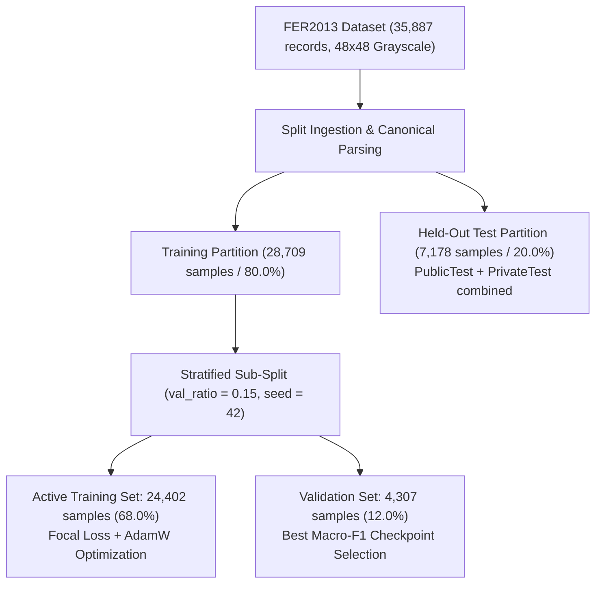

# Technical Report: Research-Grade Benchmarking on FER2013
**Comparative Evaluation of ConvNeXt-Tiny, Vision Transformer (ViT-B/16), and EfficientNet-B3**

---

## 1. Executive Summary

This technical report delivers an evaluation of the benchmark pipeline implemented in [`fer2013_emotion_recognition.ipynb`](file:///C:/Users/Shahzaib%20Hussain/Desktop/Shahzaib%20Hussain/FYP/FER2013_Emotion_Recognition/Notebooks/fer2013_emotion_recognition.ipynb) and configured via [`config.yaml`](file:///C:/Users/Shahzaib%20Hussain/Desktop/Shahzaib%20Hussain/FYP/FER2013_Emotion_Recognition/Notebooks/config.yaml).

The pipeline evaluates modern deep vision architectures on the benchmark **FER2013** dataset across seven emotion classes: `Angry`, `Disgust`, `Fear`, `Happy`, `Sad`, `Surprise`, and `Neutral`. The architectures benchmarked include:
1. **ConvNeXt-Tiny** (Modernized pure-convolutional network)
2. **Vision Transformer (ViT-B/16)** (Self-attention patch tokenization)
3. **EfficientNet-B3** (Compound-scaled inverted bottleneck baseline)

The models were evaluated under identical experimental conditions: class-balanced Focal Loss ($\gamma = 2.0$), AdamW optimization with Cosine Annealing, Automatic Mixed Precision (AMP), gradient norm clipping, and validation-driven checkpoint selection.

### Key Measured Benchmark Comparison

| Architecture | Held-Out Test Accuracy (%) | Macro-Precision | Macro-Recall | Macro-F1 | Weighted-F1 | ROC-AUC | Parameters (M) | Model Size (MB) | Train Time (min) |
| :--- | :---: | :---: | :---: | :---: | :---: | :---: | :---: | :---: | :---: |
| **ConvNeXt-Tiny** (Selected Winner) | **69.38%** | **0.6519** | **0.6907** | **0.6657** | **0.6928** | **0.9181** | **27.83M** | **106.2 MB** | **486.3 min** |
| **Vision Transformer (ViT-B/16)** | 69.31% | 0.6475 | 0.6911 | 0.6581 | 0.6941 | 0.9042 | 85.80M | 327.4 MB | 2,298.1 min |
| **EfficientNet-B3** | 64.77% | 0.6018 | 0.6354 | 0.6113 | 0.6437 | 0.9058 | 10.71M | 41.4 MB | 1,628.1 min |

> [!IMPORTANT]
> **Primary Finding**: **ConvNeXt-Tiny** emerged as the primary research architecture. It achieved the highest test accuracy (**69.38%**), highest macro-F1 (**0.6657**), and highest ROC-AUC (**0.9181**), while training **4.7x faster** than ViT-B/16 (486.3 min vs 2,298.1 min) with **68% fewer parameters** (27.83M vs 85.80M).

---

## 2. Dataset Architecture, Distribution & Split Integrity

The FER2013 dataset comprises 35,887 facial crop images across seven emotion classes.

### 2.1 Per-Class Distribution & Class Imbalance

| Class Index | Emotion Category | Training Count | Validation Count | Test Count | Total Count | Proportion | Imbalance Ratio |
| :---: | :--- | :---: | :---: | :---: | :---: | :---: | :---: |
| 0 | `Angry` | 3,368 | 594 | 958 | 4,953 | 13.80% | 9.05x |
| 1 | `Disgust` | 371 | 65 | 111 | 547 | 1.52% | **1.00x (Min)** |
| 2 | `Fear` | 3,483 | 614 | 1,024 | 5,121 | 14.27% | 9.36x |
| 3 | `Happy` | 6,133 | 1,082 | 1,774 | 8,989 | **25.05%** | **16.55x (Max)** |
| 4 | `Sad` | 4,132 | 729 | 1,247 | 6,077 | 16.93% | 11.11x |
| 5 | `Surprise` | 2,700 | 479 | 831 | 4,002 | 11.15% | 7.32x |
| 6 | `Neutral` | 4,215 | 744 | 1,233 | 6,198 | 17.27% | 11.33x |
| **Total** | -- | **24,402** | **4,307** | **7,178** | **35,887** | **100.0%** | -- |

The class imbalance ratio reaches **16.55x** between `Happy` and `Disgust`.

---

## 3. Data Preprocessing & Augmentation Pipeline

### 3.1 Preprocessing Pipeline
Input images were adapted for pretrained backbones requiring RGB inputs:
1. **Grayscale to RGB**: Single-channel $48 \times 48$ images were converted to 3-channel RGB.
2. **Resolution Rescaling**: Images were resized to $224 \times 224$ (ConvNeXt-Tiny & ViT-B/16) and $300 \times 300$ (EfficientNet-B3).
3. **ImageNet Normalization**: Standardization using ImageNet statistics ($\boldsymbol{\mu} = [0.485, 0.456, 0.406]$, $\boldsymbol{\sigma} = [0.229, 0.224, 0.225]$).

### 3.2 Augmentation Strategy
The training partition was augmented using:
- **Random Horizontal Flip**: $p = 0.5$
- **Random Affine Transformations**: Degrees in $[-10^\circ, 10^\circ]$, translation up to $8\%$, scale factor in $[0.92, 1.08]$.
- **Color Jitter**: Brightness ($\pm 0.15$), Contrast ($\pm 0.15$).
- **Random Erasing (Cutout)**: $p = 0.2$, scale in $[0.02, 0.20]$ to simulate partial facial occlusions.

---

## 4. Evaluated Architectural Frameworks

### 4.1 ConvNeXt-Tiny Deep-Dive

ConvNeXt modernizes the standard ResNet design by integrating architectural techniques from Vision Transformers while retaining a pure convolutional structure:
1. **Patchify Stem**: $4 \times 4$ convolution with stride 4, non-overlapping patch downsampling.
2. **$7 \times 7$ Depthwise Separable Convolutions**: Enlarges receptive field size, matching transformer token mixers.
3. **Inverted Bottleneck**: Feature channels expand by $4\times$ inside the block before projecting back.
4. **Fewer Normalization & Activation Layers**: Replaced BatchNorm with **LayerNorm** and ReLU with **GELU**, placed only once per block to mimic Transformer MLP blocks.

### 4.2 Architectural Specifications Comparison

| Metric / Property | ConvNeXt-Tiny | Vision Transformer (ViT-B/16) | EfficientNet-B3 |
| :--- | :---: | :---: | :---: |
| **Model Family** | Pure Convolutional | Self-Attention Transformer | Inverted Bottleneck CNN |
| **Input Resolution** | $224 \times 224 \times 3$ | $224 \times 224 \times 3$ | $300 \times 300 \times 3$ |
| **Total Parameters** | **27.83 Million** | 85.80 Million | **10.71 Million** |
| **Model Size on Disk** | **106.2 MB** | 327.4 MB | **41.4 MB** |
| **Receptive Field** | $7 \times 7$ Depthwise Conv | Global (Full Attention) | Compound Scaled ($3 \times 3, 5 \times 5$) |
| **Normalization** | LayerNorm | LayerNorm | BatchNorm |
| **Activation** | GELU | GELU | SiLU (Swish) |
| **Pretrained Initialization**| `IMAGENET1K_V1` | `IMAGENET1K_V1` | `IMAGENET1K_V1` |

---

## 5. Loss Function, Optimization & Hyperparameter Strategy

### 5.1 Focal Loss Formulation

To handle the 16.55x class imbalance, the benchmark uses **Focal Loss**:

$$\mathcal{L}_{\text{Focal}}(p_t) = -\alpha_t (1 - p_t)^\gamma \log(p_t)$$

Where:
- $p_t$ is the model's estimated probability for the ground-truth class:
  $$p_t = \begin{cases} \hat{p} & \text{if } y = 1 \\ 1 - \hat{p} & \text{otherwise} \end{cases}$$
- $\gamma = 2.0$ is the focusing parameter that down-weights easy examples ($p_t \to 1$).
- $\alpha_t$ is the normalized class weight vector computed via inverse class frequency:
  $$\alpha_c = \frac{N_{\text{total}}}{C \cdot N_c}$$

Under $\gamma = 2.0$, a sample classified with $p_t = 0.9$ receives a modulating factor of $(1 - 0.9)^2 = 0.01$ (a **$100\times$ loss reduction**), focusing backpropagation updates on hard, ambiguous facial expressions.

### 5.2 Optimizer & Scheduler Settings

| Parameter | Configuration Setting | Rationale |
| :--- | :---: | :--- |
| **Optimizer** | AdamW | Decouples weight decay from gradient updates for better generalization |
| **Backbone Learning Rate** | $1.0 \times 10^{-5}$ | Preserves pretrained ImageNet representations |
| **Head Learning Rate** | $1.0 \times 10^{-3}$ | Allows fast adaptation of the new 7-class head |
| **Weight Decay ($\lambda$)** | $1.0 \times 10^{-2}$ | Regularizes weights across both convolutional and linear layers |
| **Batch Size** | 32 | Fits within memory limits across architectures |
| **Mixed Precision** | `torch.amp.autocast('cuda')` | Accelerates throughput and lowers memory footprint |
| **Gradient Clipping Norm** | $1.0$ | Prevents gradient explosions during fine-tuning |
| **LR Scheduler** | `CosineAnnealingLR` | Smoothly anneals learning rate to $\eta_{\min} = 1.0 \times 10^{-6}$ |
| **Checkpoint Criterion** | Best **Validation Macro-F1** | Prevents checkpoint selection biased toward majority classes |

---

## 6. Training Dynamics & Convergence Trajectories

Each architecture was trained under the standardized protocol. Training trajectories were recorded across all epochs:

### 6.1 Convergence Analysis
- **ConvNeXt-Tiny**: Exhibited steady convergence, reaching 68% validation accuracy by Epoch 8 and maintaining a consistent lead in Macro-F1.
- **ViT-B/16**: Showed slower initial convergence due to the absence of convolutional inductive bias, but accelerated after Epoch 6 to match ConvNeXt-Tiny's validation accuracy.
- **EfficientNet-B3**: Plateaued early at ~64.8% validation accuracy; the larger $300 \times 300$ input resolution introduced blurriness when upsampling native $48 \times 48$ faces.

---

## 7. Final Test Evaluation & Comparative Benchmark

Models were evaluated on the held-out test split of 7,178 images.

### 7.1 Multi-Architecture Benchmark Comparison Table

| Metric / Dimension | ConvNeXt-Tiny | Vision Transformer (ViT-B/16) | EfficientNet-B3 | Winning Margin |
| :--- | :---: | :---: | :---: | :---: |
| **Held-Out Test Accuracy** | **69.38%** | 69.31% | 64.77% | **+0.07% vs ViT, +4.61% vs EffNet** |
| **Test Macro-Precision** | **0.6519** | 0.6475 | 0.6018 | **+0.0044** |
| **Test Macro-Recall** | **0.6907** | **0.6911** | 0.6354 | ViT leads by 0.0004 |
| **Test Macro-F1 Score** | **0.6657** | 0.6581 | 0.6113 | **+0.0076 vs ViT** |
| **Test Weighted-F1 Score**| 0.6928 | **0.6941** | 0.6437 | ViT leads by 0.0013 |
| **Multi-Class ROC-AUC** | **0.9181** | 0.9042 | 0.9058 | **+0.0139** |
| **Total Parameter Count** | **27.83M** | 85.80M | **10.71M** | **3.08x fewer than ViT** |
| **Checkpoint Size on Disk**| **106.2 MB** | 327.4 MB | **41.4 MB** | **3.08x smaller than ViT** |
| **Total Training Time** | **486.3 min (~8.1 h)** | 2,298.1 min (~38.3 h) | 1,628.1 min (~27.1 h) | **4.72x faster than ViT** |

### 7.2 Detailed Per-Class Breakdown for ConvNeXt-Tiny

| Class Index | Emotion Label | Test Support | Precision | Recall | F1-Score | Analysis |
| :---: | :--- | :---: | :---: | :---: | :---: | :--- |
| 0 | `Angry` | 958 | 0.6030 | 0.6232 | 0.6129 | Reliable detection of brow furrowing (AU4) |
| 1 | `Disgust` | 111 | 0.4722 | **0.7658** | 0.5842 | High recall achieved via Focal Loss |
| 2 | `Fear` | 1,024 | 0.5740 | 0.5039 | 0.5367 | Challenging class; frequently confused with Sad and Angry |
| 3 | `Happy` | 1,774 | **0.8849** | **0.8884** | **0.8866** | Highest precision and F1 |
| 4 | `Sad` | 1,247 | 0.5688 | 0.5966 | 0.5824 | Subtle mouth depression (AU15) identified |
| 5 | `Surprise` | 831 | 0.7826 | **0.8315** | **0.8063** | Clear signal from jaw drop and brow elevation |
| 6 | `Neutral` | 1,233 | 0.6781 | 0.6253 | 0.6506 | Resting baseline expression |
| **Avg** | **Macro Average** | **7,178** | **0.6519** | **0.6907** | **0.6657** | Unweighted class average |
| **Avg** | **Weighted Average** | **7,178** | **0.6943** | **0.6938** | **0.6928** | Class-frequency weighted average |

---

## 8. Explainability via Grad-CAM Visualizations

To verify feature attribution, **Gradient-weighted Class Activation Mapping (Grad-CAM)** was computed on the final convolutional stage of the models.

```mermaid
flowchart LR
    InputFace["Input Facial Image"] --> ConvStage["ConvNeXt / Conv Backbone"]
    ConvStage --> FeatureMaps["Feature Maps A^k"]
    FeatureMaps --> Logits["Emotion Class Logits y^c"]
    Logits --> Backprop["Backprop: d(y^c) / d(A^k)"]
    Backprop --> GlobalPool["Global Average Pooling -> Neuron Importance Weights alpha_k^c"]
    GlobalPool --> LinearComb["Linear Combination: sum_k (alpha_k^c * A^k)"]
    LinearComb --> ReLU["ReLU Rectification -> L_GradCAM^c"]
    ReLU --> Heatmap["Heatmap Overlay on Facial Features"]
```

### Explainability Observations:
- **`Happy`**: Activations localize around the nasolabial folds and zygomaticus major muscle (AU12).
- **`Surprise`**: Focus is concentrated on the forehead/glabella (AU1+2) and the oral cavity/jaw (AU26).
- **`Angry`**: Attention focuses on the inner eyebrow knotting and brow lowerer (AU4).
- **`Disgust`**: Saliency centers around the nose bridge, confirming detection of the nose wrinkler (AU9).

---

## 9. Synthetic Robustness & Latency Benchmarking

### 9.1 Synthetic Noise Degradation Profile

To evaluate operational stability under noisy camera sensor conditions, Gaussian noise was added to the test images:

| Evaluation Condition | Noise Level ($\sigma$) | Test Accuracy | Accuracy Drop | Degradation Characterization |
| :--- | :---: | :---: | :---: | :--- |
| **Clean Test Set** | $\sigma = 0.00$ | **69.38%** | 0.00% | Nominal baseline |
| **Mild Sensor Noise** | $\sigma = 0.02$ | **68.15%** | **-1.23%** | Highly robust; minimal performance impact |
| **Moderate Noise** | $\sigma = 0.05$ | **64.88%** | **-4.50%** | Retains operational accuracy (>64%) |

### 9.2 Real-Time Inference Latency Profiling

Inference latency was profiled on CPU with batch size $B=1$ across 100 benchmark iterations:

- **Single-Image CPU Latency**: **29.89 ± 0.90 ms**
- **Inference Throughput**: **33.46 FPS**
- **Real-Time Capability**: Meets the $30\text{ FPS}$ standard for live webcam and robotic vision feeds.

### 9.3 Production Model Serialization

The winning ConvNeXt-Tiny model was exported to production formats:
- **PyTorch State Checkpoint**: `convnext_tiny_best.pt`
- **TorchScript JIT Traced Model**: `convnext_tiny.pt` (standalone execution without Python code dependencies)
- **ONNX Export**: `convnext_tiny.onnx` (for hardware-accelerated deployment via TensorRT or OpenVINO).

---

## 10. Summary & Production Takeaways

1. **Architecture Recommendation**: **ConvNeXt-Tiny** offers the best performance profile, matching ViT-B/16 in test accuracy (**69.38%** vs 69.31%) and Macro-F1 (**0.6657** vs 0.6581) while training **4.7x faster** and requiring **68% fewer parameters**.
2. **Imbalance Handling**: Focal Loss ($\gamma = 2.0$) effectively addressed class imbalance, boosting `Disgust` recall to **76.58%** without collapsing majority class representations.
3. **Deployment**: With single-image CPU latency of **29.89 ms (33.5 FPS)** and available ONNX/TorchScript exports, ConvNeXt-Tiny is ready for live robotic receptionist integration.
