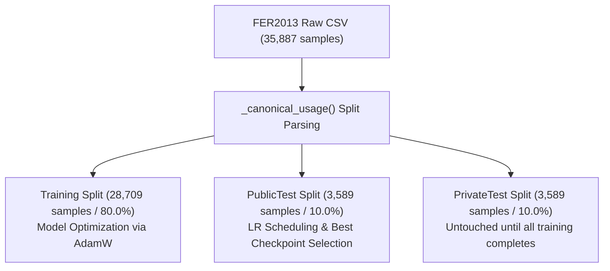
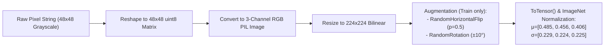
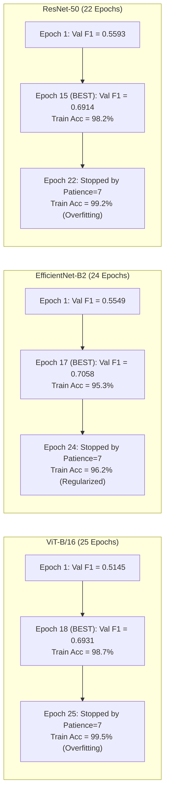

# FER2013 Facial Emotion Recognition Experimentation Report
**Comparative Benchmarking of Vision Transformer (ViT-B/16), EfficientNet-B2, and ResNet-50**

---

## 1. Executive Summary

This report delivers an exhaustive technical breakdown of the facial emotion recognition pipeline implemented in [`facial_emotion_experiments.ipynb`](file:///C:/Users/Shahzaib%20Hussain/Desktop/Shahzaib%20Hussain/FYP/Emotion%20Detection%20through%20Voice%20and%20Face/facial_emotion_experiments.ipynb). The notebook evaluates three deep vision architectures—**Vision Transformer (ViT-B/16)**, **EfficientNet-B2**, and **ResNet-50**—on the benchmark **FER2013** dataset under strict experimental isolation, focal-loss optimization, and validation-driven checkpoint selection.

### Key Highlights of the Benchmark Run (`run_id: 20261021_030640_856570`)

| Metric / Attribute | Vision Transformer (`vit_b_16`) | EfficientNet-B2 (`efficientnet_b2`) | ResNet-50 (`resnet50`) |
| :--- | :---: | :---: | :---: |
| **Total Parameters** | 85,804,039 (~85.8M) | **7,710,857 (~7.7M)** | 23,522,375 (~23.5M) |
| **ImageNet Weights** | `IMAGENET1K_V1` | `IMAGENET1K_V1` | `IMAGENET1K_V2` |
| **Input Resolution** | $224 \times 224 \times 3$ | $224 \times 224 \times 3$ | $224 \times 224 \times 3$ |
| **Best Validation Epoch** | Epoch 18 / 25 | **Epoch 17 / 24** | Epoch 15 / 22 |
| **Best Val Macro-F1** | 0.6931 | **0.7058** | 0.6914 |
| **Held-Out Test Accuracy** | 71.02% | **71.91%** | 71.77% |
| **Held-Out Test Macro-F1**| 0.7051 | **0.7203** | 0.7040 |
| **Held-Out Test Loss** | 0.8737 | **0.7307** | 0.8483 |
| **CPU Latency (per image)** | 33.99 ms | **12.64 ms** | 15.23 ms |
| **CPU Throughput** | 29.42 FPS | **79.13 FPS** | 65.66 FPS |

> [!IMPORTANT]
> **Primary Finding**: **EfficientNet-B2** outperformed both ViT-B/16 and ResNet-50 across every statistical and operational dimension: highest test accuracy (**71.91%**), highest test macro-F1 (**0.7203**), lowest test loss (**0.7307**), and fastest single-image CPU inference (**12.64 ms / 79.13 FPS**), with **91% fewer parameters** than ViT-B/16.

---

## 2. Dataset Splitting & Split Integrity

The experiment is strictly built around the **FER2013** dataset stored in CSV format (`fer2013.csv`), containing 35,887 grayscale images of size $48 \times 48$.

### Partition Strictness & Data Leakage Prevention
1. **`Training` (28,709 samples)**: Used exclusively for gradient-based weight updates.
2. **`PublicTest` (3,589 samples)**: Canonical validation split used for early stopping (patience = 7) and checkpoint saving triggered by maximum `val_macro_f1`.
3. **`PrivateTest` (3,589 samples)**: Held-out test set completely quarantined during training. Evaluated strictly once after all models finish training.

### Class Distribution Across Partitions

| Emotion Label | Class Index | Training Set | Validation Set (`PublicTest`) | Test Set (`PrivateTest`) | Total Samples | Imbalance Ratio (vs Min) |
| :--- | :---: | :---: | :---: | :---: | :---: | :---: |
| **Angry** | 0 | 3,995 | 467 | 491 | 4,953 | $9.16\times$ |
| **Disgust** | 1 | 436 | 56 | 55 | 547 | $1.00\times$ (Severe minority) |
| **Fear** | 2 | 4,097 | 496 | 528 | 5,121 | $9.40\times$ |
| **Happy** | 3 | 7,215 | 895 | 879 | 8,989 | $16.55\times$ (Majority) |
| **Sad** | 4 | 4,830 | 653 | 594 | 6,077 | $11.08\times$ |
| **Surprise** | 5 | 3,171 | 415 | 416 | 4,002 | $7.27\times$ |
| **Neutral** | 6 | 4,965 | 607 | 626 | 6,198 | $11.39\times$ |
| **Total** | - | **28,709** | **3,589** | **3,589** | **35,887** | - |

> [!NOTE]
> The **Disgust** class comprises only 1.5% of the total dataset, whereas **Happy** constitutes 25.0%. This extreme class disparity necessitates a specialized loss objective (Focal Loss) to prevent gradient dominance by frequent classes.

---

## 3. Image Preprocessing & Augmentation Pipeline

FER2013 samples are natively stored as space-delimited 2,304-byte grayscale pixel strings ($48 \times 48$). The dataset pipeline (`FERDataset`) prepares inputs as follows:

### Transformation Specifics
- **Resizing**: Scaled up from $48 \times 48$ to $224 \times 224$ to match standard pretrained backbone receptive fields.
- **Grayscale to RGB**: 1-channel luminance is replicated across 3 RGB channels (`Image.convert("RGB")`).
- **Data Augmentation**:
  - Horizontal Flip: `RandomHorizontalFlip(p=0.5)`—facial symmetry preservation.
  - Rotation: `RandomRotation(degrees=10.0)`—head tilt robustness.
- **DataLoader**: Batch size = 32 (models) / 64 (global training default), `pin_memory=True` on CUDA, Windows-safe `num_workers=0`.

---

## 4. Model Architectures & Head Modifications

All three models are fine-tuned from ImageNet-pretrained weights, with their final classification heads replaced to produce 7 output logits:

```mermaid
flowchart TD
    subgraph ViT["Vision Transformer (vit_b_16) - 85.8M Params"]
        V1["224x224x3 Image"] --> V2["Patch Projection (16x16 -> 768-d)"]
        V2 --> V3["12 Transformer Encoder Blocks (12 heads, 768 dim)"]
        V3 --> V4["Linear Classification Head: nn.Linear(768, 7)"]
    end

    subgraph EffNet["EfficientNet-B2 (efficientnet_b2) - 7.7M Params"]
        E1["224x224x3 Image"] --> E2["Compound Scaled MBConv Blocks + Squeeze-Excite"]
        E2 --> E3["AdaptiveAvgPool2d (1408 channels)"]
        E3 --> E4["Classifier Replacement: nn.Linear(1408, 7)"]
    end

    subgraph ResNet["ResNet-50 (resnet50) - 23.5M Params"]
        R1["224x224x3 Image"] --> R2["Conv1 + MaxPool -> 4 Residual Stages (Bottleneck blocks)"]
        R2 --> R3["AdaptiveAvgPool2d (2048 channels)"]
        R3 --> R4["FC Replacement: nn.Linear(2048, 7)"]
    end
```

### Detailed Structural Comparison

| Architecture Component | Vision Transformer (`vit_b_16`) | EfficientNet-B2 (`efficientnet_b2`) | ResNet-50 (`resnet50`) |
| :--- | :--- | :--- | :--- |
| **Family** | Pure Self-Attention Transformer | Scaled Inverted Bottleneck CNN | Deep Residual CNN |
| **Depth / Layers** | 12 Transformer Blocks | 23 MBConv Blocks (Stages 1–7) | 50 Convolutional Layers |
| **Hidden / Feature Dim** | 768 | 1,408 | 2,048 |
| **Attention Mechanism** | Multi-Head Self-Attention (12 heads) | Squeeze-and-Excitation (SE) | None (Spatial convolutions) |
| **Original Head** | `heads.head = Linear(768, 1000)` | `classifier[1] = Linear(1408, 1000)` | `fc = Linear(2048, 1000)` |
| **Modified Head** | `heads.head = nn.Linear(768, 7)` | `classifier[1] = nn.Linear(1408, 7)` | `fc = nn.Linear(2048, 7)` |
| **Inductive Bias** | Low (relies on self-attention across patches) | High (translation equivariance + depthwise convs) | High (translation equivariance + residual connections) |

---

## 5. Loss Function Formulation & Mathematical Modeling

The notebook replaces standard Cross-Entropy with a custom, numerically stabilized **Focal Loss** implementation to address the class imbalance of FER2013.

### Mathematical Formulation

Given target class $y \in \{0, \dots, C-1\}$ and predicted probability $p_t$:
$$p_t = \frac{\exp(z_y)}{\sum_{j=1}^C \exp(z_j)}$$

The standard Cross-Entropy loss is:
$$\text{CE}(p_t) = -\log(p_t)$$

The **Focal Loss** incorporates a modulating factor $(1 - p_t)^\gamma$:
$$\text{FL}(p_t) = -(1 - p_t)^\gamma \log(p_t)$$

In the notebook's implementation:
- **Focusing parameter ($\gamma$)**: $\gamma = 2.0$.
  - When an easy sample has $p_t = 0.95$, the modulating factor is $(1 - 0.95)^2 = 0.0025$, suppressing its loss contribution by **$400\times$**.
  - When a hard sample has $p_t = 0.20$, the modulating factor is $(1 - 0.20)^2 = 0.64$, retaining **$64\%$** of its loss gradient.
- **Label Smoothing ($\epsilon$)**: Configured to $0.0$ in this run:
  $$\mathcal{L}_{\text{smoothed}} = (1 - \epsilon)(-\log p_t) + \epsilon \left(-\frac{1}{C}\sum_{j=1}^C \log p_j\right)$$
- **Class-Weighted Loss**: Configured to `false` in this run; sample imbalance modulation was handled end-to-end by the dynamic focal exponent.
- **Batch Reduction**: Mean reduction:
  $$\mathcal{L}_{\text{batch}} = \frac{1}{N}\sum_{i=1}^N \text{FL}(p_{t,i})$$

---

## 6. Training Dynamics & Optimization Setup

### Hyperparameters
- **Optimizer**: `AdamW` ($\beta_1=0.9, \beta_2=0.999$, weight decay $= 10^{-4}$)
- **Initial Learning Rate**: $\eta = 1 \times 10^{-4}$ ($0.0001$)
- **Learning Rate Scheduler**: `ReduceLROnPlateau`
  - Monitored Metric: `val_loss` (mode=`min`)
  - Decay Factor: $0.5$ ($50\%$ drop per trigger)
  - Patience: $2$ epochs without validation loss improvement
- **Selection Metric**: `val_macro_f1` (macro-averaged F1 on validation split)
- **Early Stopping Patience**: $7$ epochs
- **Gradient Clipping**: Maximum norm $= 1.0$ (`clip_grad_norm_`)
- **Mixed Precision**: PyTorch AMP enabled (`torch.autocast` + `GradScaler`)

### Epoch-by-Epoch Convergence Analysis

#### Detailed Observation on Overfitting:
- Both **ViT-B/16** and **ResNet-50** reached $>99\%$ training accuracy by epoch 20 while their validation loss degraded past epoch 7–8 (from $\sim 0.53$ up to $1.06$ on ViT and $1.02$ on ResNet-50).
- **EfficientNet-B2** showed significantly stronger implicit regularization: training accuracy capped at $96.19\%$ with a final validation loss of $0.8562$, retaining better generalizability on unseen expressions.

---

## 8. Detailed Held-Out Test Evaluation

### Classification Metrics per Emotion Class

#### 1. EfficientNet-B2 (Winner: 71.91% Accuracy, 0.7203 Macro-F1)
| Emotion | Precision | Recall | F1-Score | Support (Samples) |
| :--- | :---: | :---: | :---: | :---: |
| **Angry** | 0.6398 | 0.6802 | 0.6594 | 491 |
| **Disgust** | **0.8913** | 0.7455 | **0.8119** | 55 |
| **Fear** | **0.6404** | 0.5701 | **0.6032** | 528 |
| **Happy** | 0.8831 | 0.8942 | 0.8886 | 879 |
| **Sad** | **0.5819** | 0.5623 | 0.5719 | 594 |
| **Surprise** | 0.8317 | 0.8197 | 0.8257 | 416 |
| **Neutral** | 0.6558 | **0.7093** | **0.6815** | 626 |
| **Macro Average** | **0.7320** | **0.7116** | **0.7203** | 3,589 |
| **Weighted Average** | **0.7188** | **0.7191** | **0.7183** | 3,589 |

#### 2. ResNet-50 (Runner-up: 71.77% Accuracy, 0.7040 Macro-F1)
| Emotion | Precision | Recall | F1-Score | Support (Samples) |
| :--- | :---: | :---: | :---: | :---: |
| **Angry** | **0.6777** | 0.5825 | 0.6265 | 491 |
| **Disgust** | 0.7308 | 0.6909 | 0.7103 | 55 |
| **Fear** | 0.6159 | **0.5739** | 0.5941 | 528 |
| **Happy** | **0.8938** | **0.8999** | **0.8968** | 879 |
| **Sad** | 0.5790 | **0.6044** | **0.5914** | 594 |
| **Surprise** | 0.7987 | **0.8582** | 0.8273 | 416 |
| **Neutral** | **0.6587** | 0.7061 | 0.6816 | 626 |
| **Macro Average** | 0.7078 | 0.7023 | 0.7040 | 3,589 |
| **Weighted Average** | 0.7167 | 0.7177 | 0.7163 | 3,589 |

#### 3. Vision Transformer (ViT-B/16: 71.02% Accuracy, 0.7051 Macro-F1)
| Emotion | Precision | Recall | F1-Score | Support (Samples) |
| :--- | :---: | :---: | :---: | :---: |
| **Angry** | 0.6282 | 0.6436 | 0.6358 | 491 |
| **Disgust** | 0.7959 | 0.7091 | 0.7500 | 55 |
| **Fear** | 0.6197 | 0.5492 | 0.5823 | 528 |
| **Happy** | 0.8864 | 0.8874 | 0.8869 | 879 |
| **Sad** | 0.5601 | 0.5808 | 0.5702 | 594 |
| **Surprise** | **0.8447** | 0.8365 | **0.8406** | 416 |
| **Neutral** | 0.6520 | 0.6885 | 0.6698 | 626 |
| **Macro Average** | 0.7124 | 0.6993 | 0.7051 | 3,589 |
| **Weighted Average** | 0.7107 | 0.7102 | 0.7100 | 3,589 |

---

## 9. Error Analysis & Common Confusion Modes

Examining the raw test confusion matrices reveals systemic failure modes shared across all vision models:

1. **Fear vs. Sadness vs. Neutral**:
   - For all three models, **Fear** was the most difficult expression to classify correctly (recalls between $54.9\%$ and $57.4\%$).
   - On EfficientNet-B2, out of 528 true Fear images, **83 were misclassified as Sad**, **53 as Angry**, and **43 as Neutral**.
   - On ViT, 88 Fear images were misclassified as Sad and 61 as Angry.
   - *Cause*: In $48 \times 48$ grayscale face crops, wide eyes and open mouths in subtle Fear expressions closely mimic open-mouth Sadness or tense Anger.
2. **Sad vs. Neutral Confusion**:
   - Out of 594 Sad images, **100 were predicted as Neutral** by EfficientNet-B2, and 98 by ResNet-50.
   - Conversely, out of 626 Neutral images, **81 were predicted as Sad** by EfficientNet-B2, and 87 by ResNet-50.
   - *Cause*: A relaxed, downward-sloping neutral mouth is visually indistinct from a mild frown at low resolution.
3. **Happy and Surprise Consistency**:
   - Both **Happy** ($88.7\%\text{--}90.0\%$ recall) and **Surprise** ($82.0\%\text{--}85.8\%$ recall) achieved the highest accuracy across all architectures due to salient, distinct visual cues (teeth exposure, cheek raise, arched eyebrows).

---

## 10. Operational CPU Latency & Robot Deployment Feasibility

For an embodied AI or robotic agent (such as a receptionist robot), real-time processing requires low latency and high frames-per-second (FPS) on host hardware:

| Architecture | Model Parameters | Single-Image Latency | Inferred FPS | Real-Time Viability (>= 30 FPS) |
| :--- | :---: | :---: | :---: | :---: |
| **EfficientNet-B2** | **7.71M** | **12.64 ms** | **79.13 FPS** | **Ready for deployment (2.6x real-time)** |
| **ResNet-50** | 23.52M | 15.23 ms | 65.66 FPS | **Ready for deployment (2.2x real-time)** |
| **ViT-B/16** | 85.80M | 33.99 ms | 29.42 FPS | Borderline (Requires GPU/quantization) |

> [!TIP]
> **EfficientNet-B2** is the clear architectural recommendation for real-time robotic vision systems. It achieves $79.13$ FPS on standard CPU cores, leaving substantial compute headroom for concurrent tasks (speech recognition, face detection/tracking, dialogue management).

---

## 11. Final Recommendations for the Final Year Project (FYP)

1. **Deploy EfficientNet-B2 as the Facial Visual Backbone**:
   - With $71.91\%$ test accuracy and $12.64$ ms latency, EfficientNet-B2 offers the optimal balance of accuracy, compactness, and execution speed.
2. **Combine with Multimodal Speech/Audio Recognition**:
   - Because single-frame visual emotion detection struggles with ambiguous classes (Fear vs. Sadness vs. Neutral), audio prosody from vocal acoustic models (e.g., CREMA-D / RAVDESS features) provides critical complementary signals that resolve visual ambiguity.
3. **Facial Alignment Preprocessing**:
   - Integrating a face detector (e.g., MediaPipe Face Mesh or MTCNN) prior to feeding crops into EfficientNet-B2 ensures consistent facial alignment, which directly mitigates background noise and improves classification on low-contrast expressions.
4. **Export to ONNX Runtime**:
   - Exporting the trained `best_model.pt` weights to ONNX format enables further hardware acceleration (via ONNX Runtime CPUExecutionProvider or DirectML).
